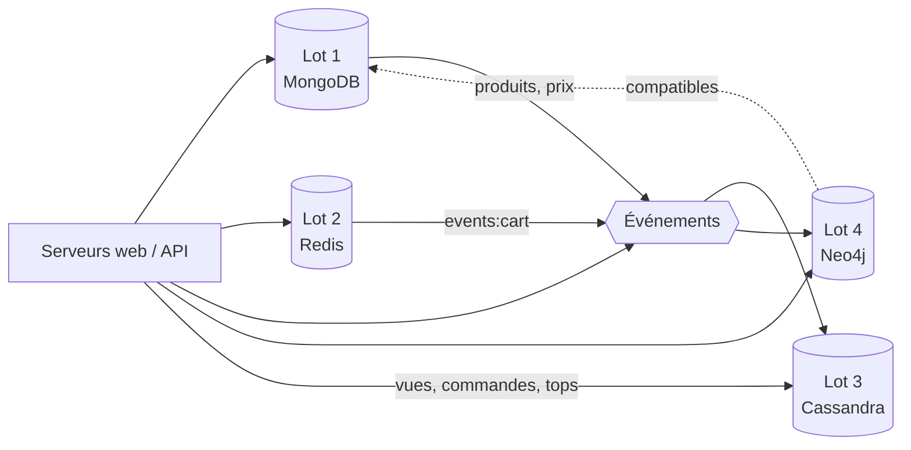

# Refonte LDLC — Architecture de données NoSQL

**Projet NSL NoSQL, en binôme**

| Membre | |
|---|---|
| FOPA DORCEL LE DOUX | membre 1 |
| LATOUNDJI Mohamed Farouck| membre 2 |

## Le projet en deux minutes

LDLC (e-commerce high-tech, plus de 27 000 références, jusqu'à 25 000 colis par jour) quitte sa base relationnelle monolithique. Nous concevons la nouvelle architecture de données en **persistance polyglotte** : chaque besoin reçoit la famille NoSQL adaptée à sa façon d'accéder aux données.

| Lot | Besoin | Famille | Technologie | État |
|---|---|---|---|---|
| 1. Catalogue produits | Fiches à schéma variable, très lues | Document | **MongoDB** | Terminé, testé |
| 2. Panier et sessions | Latence < 1 ms, expiration automatique | Clé-valeur | **Redis** | Terminé, testé |
| 3. Logs et analytics | Millions d'écritures par jour | Colonne | **Cassandra** | Terminé, testé |
| 4. Recommandations | Parcours de relations | Graphe | **Neo4j** | Terminé, testé |

Les quatre bases partagent un identifiant produit commun, le **SKU** (`CPU-000001`).



## Démarrer

Prérequis : Docker. Depuis la racine du dépôt :

```bash
docker compose up -d
```

Le premier démarrage charge les quatre bases en parallèle, chacune par son conteneur ponctuel :
- **MongoDB :** le catalogue, soit 66 778 produits réels (environ 20 secondes, scripts Python) ;
- **Redis :** les fonctions du panier, la réplique du catalogue et les sessions de démonstration
- **Cassandra :** 7 jours d'événements, les compteurs, les commandes et l'historique des prix
- **Neo4j :** le graphe des produits, de leurs interfaces de compatibilité et des commandes, puis les arêtes « achetés ensemble » 

L'API démarre une fois les quatre chargements terminés. Les requêtes types de chaque lot se lancent comme indiqué dans son README.

| Base | Accès depuis la machine hôte |
|---|---|
| MongoDB (Lot 1) | `mongodb://localhost:27018` |
| Redis (Lot 2) | `localhost:6380` |
| Cassandra (Lot 3) | `localhost:9043` (datacenter `dc1`) |
| Neo4j (Lot 4) | [http://localhost:7475](http://localhost:7475) (Neo4j Browser), connexion `bolt://localhost:7688` |
| Prototype d'API (bonus) | [http://localhost:8000/docs](http://localhost:8000/docs) |

## Livrables

| # | Livrable | Emplacement |
|---|---|---|
| 1 | Dépôt GitHub du binôme | ce dépôt |
| 2 | README avec les membres | ce fichier |
| 3 | Schéma d'architecture globale | [`docs/architecture.md`](docs/architecture.md) |
| 4 | Document de conception (choix, schémas, compromis, requêtes types) | [`docs/conception.md`](docs/conception.md) |
| — | Lot 1 : scripts, données, requêtes exécutables | [`lot1-catalogue/`](lot1-catalogue/) |
| — | Lot 2 : configuration Redis, fonctions Lua, requêtes et mesures | [`lot2-panier-sessions/`](lot2-panier-sessions/) |
| — | Lot 3 : schéma CQL, chargement, job de classement, connecteur du panier, requêtes et mesures | [`lot3-logs-analytics/`](lot3-logs-analytics/) |
| — | Lot 4 : contraintes et chargement du graphe (Cypher), requêtes et mesures, job vers le Lot 1 | [`lot4-recommandations/`](lot4-recommandations/) |
| — | Conventions communes (SKU, formats, Git) | [`docs/conventions.md`](docs/conventions.md) |
| 5 | Bonus : prototype d'API (FastAPI, 23 routes sur les quatre bases, démonstration de bout en bout) | [`api/`](api/) |

## Structure

```
.
├── docker-compose.yml        environnement de développement (un service par base)
├── docs/                     conception, architecture, conventions
├── lot1-catalogue/           MongoDB : init/, lib/, queries/, data/
├── lot2-panier-sessions/     Redis : config/, functions/, init/, queries/, data/
├── lot3-logs-analytics/      Cassandra : init/, lib/, jobs/, connecteurs/, queries/, stress/, data/
├── lot4-recommandations/     Neo4j : init/, lib/, queries/, jobs/, data/
└── api/                      prototype d'API (FastAPI) : app/, demo.py
```

## Données

Catalogue : [PC Part Dataset](https://github.com/docyx/pc-part-dataset) (licence MIT, © 2021-2025 Doc Oliver). Les avis clients sont synthétiques et marqués comme tels. Détails dans [`SOURCE.md`](lot1-catalogue/data/raw/pc-part-dataset/SOURCE.md).
