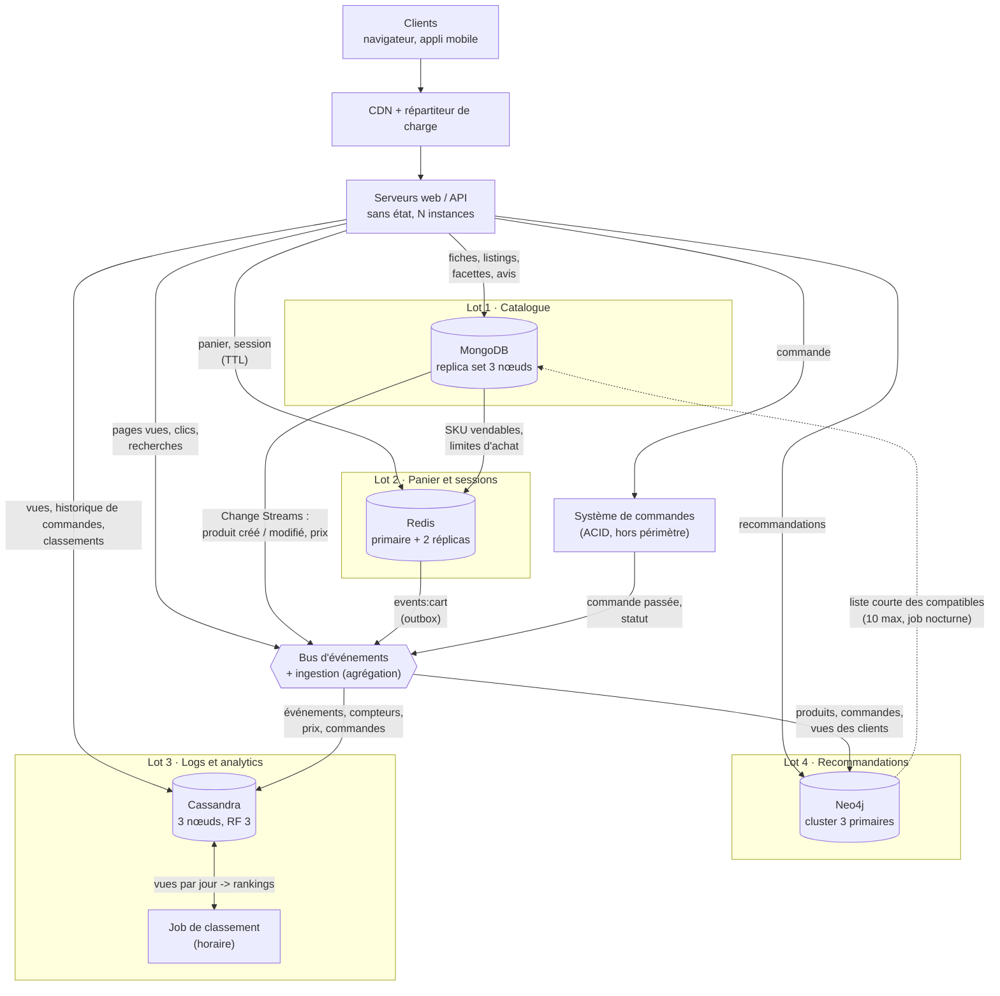
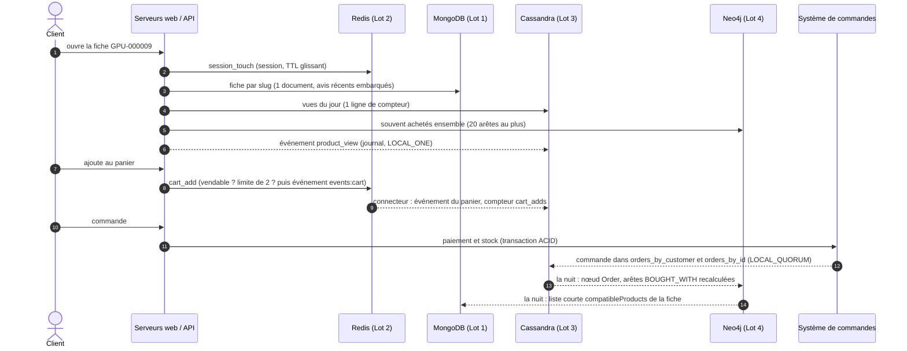

# Schéma d'architecture globale

> Les quatre lots sont conçus et testés. Les schémas montrent le déploiement de production ; en développement, chaque base tourne en un seul conteneur (`docker-compose.yml`).
> Les diagrammes sont en Mermaid : GitHub les affiche directement.

## 1. Vue d'ensemble : persistance polyglotte

| Flux | Nature | Cohérence |
|---|---|---|
| API → MongoDB | Lecture de fiches et listings (secondaires), écritures back-office (primaire, `w: majority`) | Forte à l'écriture, à terme en lecture publique |
| API → Redis | Session lue à chaque requête, panier modifié par fonctions Lua atomiques (`FCALL`) | Forte pour le client : tout passe par le primaire |
| MongoDB → Redis | Réplique des SKU vendables et des limites d'achat, rechargée par bascule atomique (`RENAME`) | À terme |
| Redis → connecteur → Cassandra | Événements du panier écrits dans le Stream `events:cart` dans la même opération que la modification (outbox), lus par un groupe de consommateurs, acquittés après écriture | À terme, au moins une fois |
| API → bus → Cassandra | Un événement par clic (`LOCAL_ONE`), compteurs agrégés par lot de quelques secondes | À terme, perte d'un clic acceptée |
| Système de commandes → Cassandra | Commande passée, changements de statut ; deux tables écrites par BATCH journalisé (`LOCAL_QUORUM`) | Forte à la lecture (quorum) |
| MongoDB → Cassandra | Chaque changement de `price.amount` ajoute une ligne à l'historique des prix | À terme |
| Job → Cassandra | Classements recalculés toutes les heures, lus en une partition | Frais à l'heure |
| MongoDB → bus → Neo4j | Propagation des produits (SKU, nom, catégorie, marque, prix en centimes, attributs de compatibilité) | À terme (quelques secondes) |
| Cassandra → Neo4j | Commandes (nœuds `Order`) et vues des clients connectés (arêtes `VIEWED`) ; `BOUGHT_WITH` recalculé chaque nuit | À terme (un jour pour les arêtes précalculées) |
| Neo4j → MongoDB | Recalcul nocturne de `compatibleProducts` (10 au plus par fiche), classés par les paniers réels puis la popularité | À terme (vitrine, non critique) |

**Identifiant commun :** le SKU (`CPU-000001`, `MB-000131`…) est la clé partagée par les quatre bases (voir [`conventions.md`](conventions.md)).

**Prototype :** le dossier [`api/`](../api/) implémente le rôle « Serveurs web / API » de ce schéma pour les quatre lots. C'est une API FastAPI sans état, avec 23 routes, la session passée dans un en-tête et le panier modifié uniquement par les fonctions Lua du Lot 2. Les étapes 1 à 9 du parcours de la section 7 y sont exécutables de bout en bout (`api/demo.py`, 24 vérifications). Les étapes 10 à 12 relèvent du système de commandes, hors périmètre. Les étapes 13 et 14 sont jouées par les exports des Lots 1 et 3, le chargement du graphe et le job `compatibles_vers_lot1.py`.

### Où vit chaque donnée

Chaque donnée a **une seule source de vérité**. Les autres bases en gardent une copie adaptée à leurs requêtes et la reçoivent par un flux.

| Donnée | Source de vérité | Copies, et pourquoi |
|---|---|---|
| Fiche produit (nom, prix, attributs) | Lot 1, MongoDB | Lot 2 : SKU vendables et limites d'achat, pour contrôler un ajout au panier sans interroger MongoDB. Lot 3 : historique des prix (obligation Omnibus). Lot 4 : nœud `Product` et ses interfaces de compatibilité |
| Avis clients et note moyenne | Lot 1, MongoDB | Aucune : les 5 avis récents sont embarqués dans la fiche (Subset pattern) |
| Session, panier | Lot 2, Redis | Lot 3 : chaque modification du panier, comme événement (`events:cart`) |
| Clic, page vue, recherche | Lot 3, Cassandra (journal brut) | Lot 3 : compteurs et classements. Lot 4 : vues des clients connectés (`VIEWED`) |
| Commande | Système de commandes (ACID, hors périmètre) | Lot 3 : historique en lecture, deux tables. Lot 4 : nœuds `Order`, base de « achetés ensemble » |
| Compatibilité entre produits | Attributs du Lot 1 (socket, mémoire, format) | Lot 4 : interfaces `REQUIRES` / `PROVIDES`. Lot 1 : liste courte `compatibleProducts`, recalculée par le Lot 4 |
| « Achetés ensemble », recommandations | Calculées par le Lot 4, à partir des commandes | Aucune : reconstructibles à tout moment |

## 2. Parcours d'un client à travers les quatre bases

Un client connecté consulte une carte graphique, l'ajoute à son panier et commande. Chaque étape touche la base faite pour elle.

| Étape | Base | Pourquoi celle-ci |
|---|---|---|
| 2 | Redis | La session est lue à chaque requête : il faut moins d'une milliseconde et une expiration automatique |
| 3 | MongoDB | La fiche a un schéma variable par catégorie et se lit en un seul document |
| 4, 6, 9 | Cassandra | Une écriture par clic, des millions par jour, avec des compteurs déjà calculés pour la lecture. L'événement du panier arrive par le connecteur |
| 5 | Neo4j | « Achetés ensemble » est un parcours de relations, borné par les arêtes précalculées |
| 8 | Redis | Une fonction Lua atomique contrôle et modifie le panier, et publie l'événement dans la même opération |
| 11 | Système de commandes | Paiement et stock exigent des transactions ACID : aucune des quatre bases n'en est la source de vérité |
| 12 à 14 | Cassandra, Neo4j, MongoDB | Copies dérivées, à terme : l'historique, les recommandations et la liste des compatibles suivent sans bloquer la commande |
