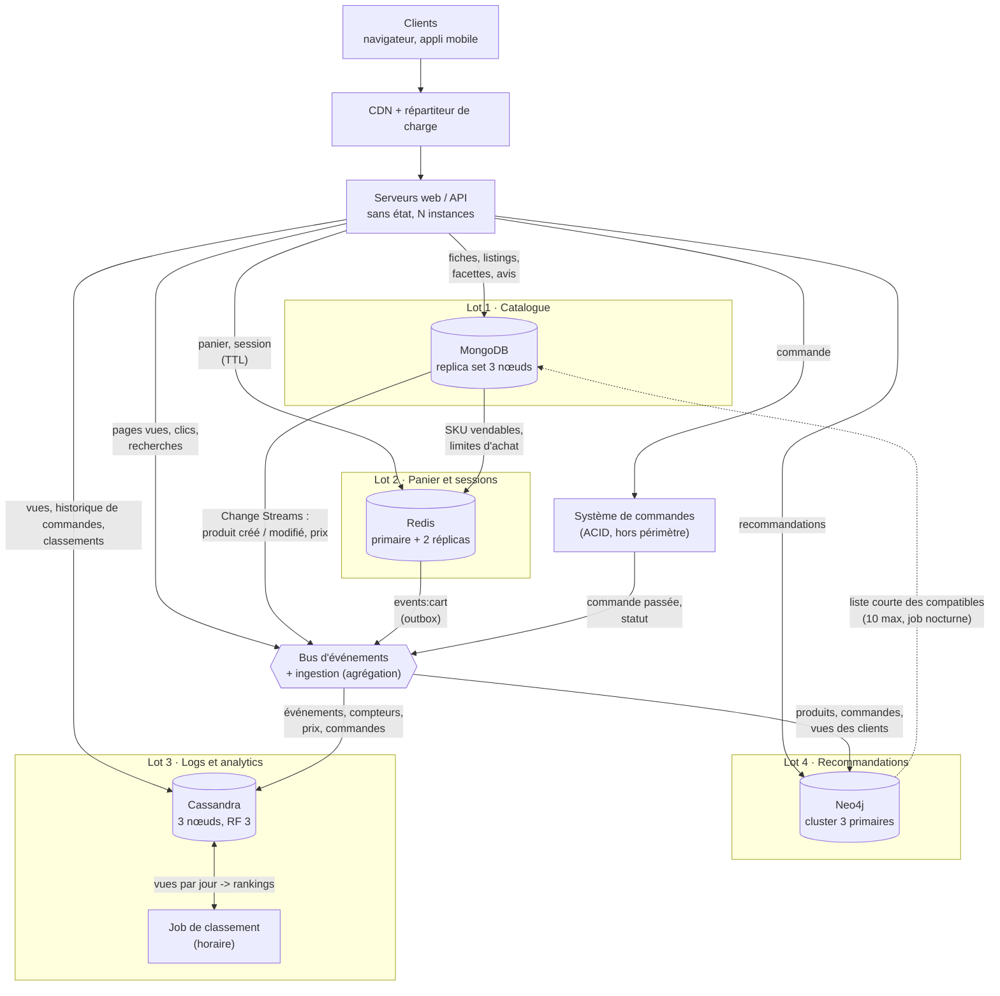
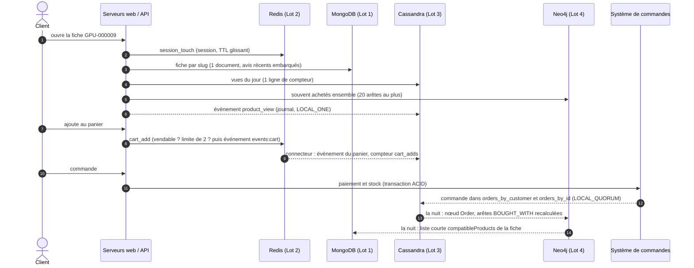

# Schéma d'architecture globale

## 1. Vue d'ensemble : persistance polyglotte

**Identifiant commun :** Le SKU (Stock Keeping Unit, « unité de gestion de stock ») est l’identifiant unique d’un produit vendu, celui qu’un commerçant utilise pour gérer son stock, son catalogue et ses ventes.
Dans ce projet, le SKU prend la forme PRÉFIXE-000000. Le préfixe indique la catégorie(voir [`conventions.md`](conventions.md)).
exemple: 
CPU-000001 : un processeur (AMD Ryzen 7 9800X3D) ;
MB-000227 : une carte mère (Gigabyte B650I AX) ;
GPU-000009 : une carte graphique (Asus ROG Astral OC, une RTX 5090) ;

## 2. Parcours d'un client à travers les quatre bases

Un client connecté consulte une carte graphique, l'ajoute à son panier et commande. Chaque étape touche la base faite pour elle.

| Étape | Base | Pourquoi celle-ci |
|---|---|---|
| 2 | Redis | La session est lue à chaque requête : il faut moins d'une milliseconde et une expiration automatique |
| 3 | MongoDB | La fiche a un schéma variable par catégorie et se lit en un seul document |
| 4, 6, 9 | Cassandra | Une écriture par clic, des millions par jour, avec des compteurs déjà calculés pour la lecture. L'événement du panier arrive par le connecteur |
| 5 | Neo4j | « Achetés ensemble » est un parcours de relations, borné par les arêtes précalculées |
| 8 | Redis | Une fonction Lua atomique contrôle et modifie le panier, et publie l'événement dans la même opération |
| 11 | Système de commandes | Paiement et stock exigent des transactions ACID : aucune des quatre bases n'en est la source de vérité |
| 12 à 14 | Cassandra, Neo4j, MongoDB | Copies dérivées, à terme : l'historique, les recommandations et la liste des compatibles suivent sans bloquer la commande |
