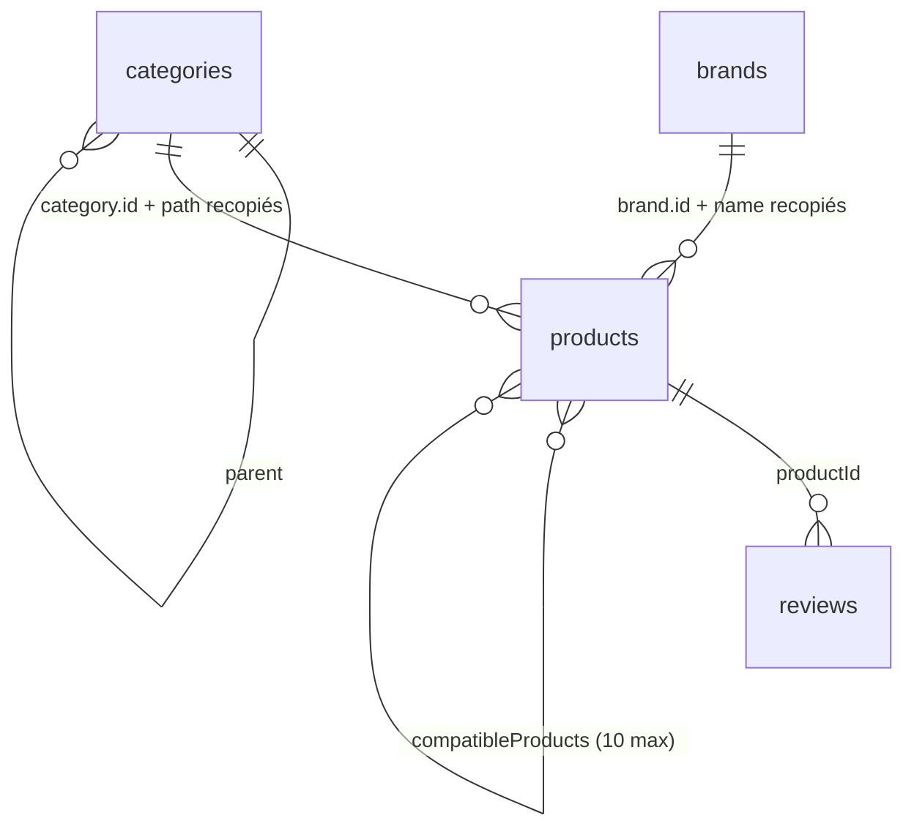

# Document de conception — Refonte des données de LDLC

> **Binôme :** NOM Prénom · NOM Prénom
> **État :** les quatre lots sont terminés et testés · prototype d'API sur les quatre bases (bonus)
> **Volume cible :** 10 pages maximum pour les 4 lots

---

## 1. Contexte et démarche

LDLC (e-commerce high-tech) : plus de 27 000 références, plus de 600 marques, des millions de visites par mois avec des pics à chaque sortie de composant, jusqu'à 25 000 colis par jour. La base relationnelle monolithique ne suit plus.

**Principe : persistance polyglotte.** Chaque lot a un profil d'accès différent, donc reçoit la famille NoSQL adaptée. Pour chaque lot, on suit la même démarche : (1) lister les requêtes métier, (2) caractériser la charge, (3) placer le besoin dans le théorème CAP, (4) choisir la famille puis la technologie en écartant les alternatives, (5) modéliser à partir des requêtes, (6) écrire les compromis, (7) prouver le modèle par des requêtes types.

| Lot | Besoin dominant | Famille | Technologie | État |
|---|---|---|---|---|
| 1. Catalogue | Schéma variable, lecture intensive, sous-documents | Document | **MongoDB 8** | Terminé |
| 2. Panier et sessions | Latence < 1 ms, expiration automatique, partage entre serveurs | Clé-valeur | **Redis 7.2** | Terminé |
| 3. Logs et analytics | Écritures massives, séries temporelles, rétention longue | Colonne | **Cassandra 5.0** | Terminé |
| 4. Recommandations | Parcours de relations sur plusieurs niveaux | Graphe | **Neo4j 5.26** | Terminé |

Le schéma d'architecture globale est dans [`architecture.md`](architecture.md), les conventions communes aux lots dans [`conventions.md`](conventions.md).

---

## 2. Lot 1 — Catalogue produits (MongoDB)

### 2.1 Données utilisées

Jeu public **PC Part Dataset** (licence MIT) : **66 778 produits** réels en 25 catégories, dont 16 222 en vente (avec un prix) et 50 556 arrêtés. Chaque catégorie a ses propres attributs (un processeur a `core_count` et `tdp`, une carte mère `socket` et `form_factor`), ce qui correspond exactement à la contrainte « schémas variables ». Le jeu ne contient pas d'avis : **96 236 avis synthétiques** sont générés de façon déterministe et marqués `synthetic: true`. Détails : [`lot1-catalogue/data/raw/pc-part-dataset/SOURCE.md`](../lot1-catalogue/data/raw/pc-part-dataset/SOURCE.md).

### 2.2 Requêtes métier (Query-Driven)

| # | Requête | Fréquence | Exigence |
|---|---|---|---|
| R1 | Afficher une fiche produit (caractéristiques, note, derniers avis, compatibles) | Très forte | 1 seule lecture |
| R2 | Lister une catégorie **et ses sous-catégories**, trié par prix, paginé | Très forte | Tri porté par l'index |
| R3 | Filtrer par caractéristiques (socket, nombre de cœurs, TDP…) | Forte | Attributs différents selon la catégorie |
| R4 | Compter les produits par valeur de filtre (facettes) | Forte | Facettes définies par catégorie |
| R5 | Lire les avis au-delà des plus récents | Moyenne | Pagination |
| R6 | Recherche plein texte | Forte | Pertinence |
| R7 | Produits d'une marque | Moyenne | Tri par prix |
| R8 | Les mieux notés d'une catégorie | Moyenne | Note précalculée |
| E1-E7 | Dépôt et modération d'un avis, changement de prix, renommage, fin de commercialisation | Faible | Coût connu et borné |
| I1-I5 | Créer une fiche, importer un lot ou le flux d'un fournisseur, créer une marque | Faible (back-office, imports nocturnes) | Validées, sans doublon, rejouables |
| U1-U8 | Modifier une fiche ou un attribut, voter pour un avis, modifier en masse, anonymiser un client | Faible à moyenne (votes) | Atomiques par document, sans écraser une modification concurrente |
| V1-V3 | Nouvelle catégorie, nouvel attribut, changement de structure | Rare | **Sans migration** |

### 2.3 Choix technologique : MongoDB

| Contrainte du sujet | Réponse de MongoDB |
|---|---|
| Schémas variables selon les catégories | Documents BSON sans structure imposée ; validation `$jsonSchema` limitée au tronc commun |
| Évolution sans migration | Ajouter un champ ou une catégorie = écrire des documents ; aucun `ALTER` (démontré en V1 à V3) |
| Lectures très fréquentes, écritures rares | Une fiche = un document lu en une opération ; index secondaires riches ; lectures réparties sur les secondaires d'un replica set |
| Sous-documents (avis, spécifications, compatibles) | Sous-documents et tableaux natifs, indexables (index multikey) |

**Alternatives écartées**

| Alternative | Pourquoi pas pour le catalogue |
|---|---|
| PostgreSQL + JSONB | Techniquement crédible (JSONB + index GIN). Écarté : on sort du monolithe relationnel, la montée en charge horizontale est moins native, et avis et compatibles ramèneraient des jointures. |
| Cassandra (colonne) | Une table par requête, filtres limités à la clé primaire : impossible de filtrer sur des attributs qui changent selon la catégorie. Adapté au Lot 3, pas ici. |
| Redis (clé-valeur) | Une fiche serait une valeur opaque : pas de filtre sur ses attributs, pas d'index secondaire. Utile en cache devant MongoDB. |
| Neo4j (graphe) | Fait pour les relations (Lot 4), pas pour stocker des fiches riches et paginer des listings. |
| Elasticsearch | Excellent moteur de recherche et de facettes, mais pas une base de référence (cohérence à terme, pas de validation). Évolution possible : index de recherche alimenté depuis MongoDB. |

### 2.4 Modèle de données

Quatre collections. `products` est autonome pour l'affichage, `reviews` est la source de vérité des avis :



Extrait d'une fiche (`MB-000131`, 3,4 Ko au complet) :

```python
{
    "_id": "MB-000131",                       # SKU : identifiant commun aux 4 lots
    "schemaVersion": 1,                       # Schema Versioning
    "type": "physical",                       # Polymorphic : "physical" | "software"
    "name": "MSI PRO B760-P WIFI DDR4",
    "slug": "msi-pro-b760-p-wifi-ddr4-mb-000131",
    "brand": {"id": "msi", "name": "MSI"},    # Extended Reference
    "category": {"id": "cartes-meres", "name": "Cartes mères", "path": ["composants", "cartes-meres"]},  # Tree
    "status": "active",
    "price": {"amount": Decimal128("159.95"), "currency": "USD"},  # Decimal128 : pas d'erreur d'arrondi
    "specs": [{"k": "socket", "v": "LGA1700"}, {"k": "form_factor", "v": "ATX"},
              {"k": "max_memory", "v": 128, "u": "Go"}, {"k": "memory_slots", "v": 4}],  # Attribute
    "rating": {"count": 21, "sum": 91, "average": 4.33,
               "distribution": {"1": 0, "2": 0, "3": 1, "4": 12, "5": 8}},             # Computed
    "recentReviews": [{"reviewId": ..., "rating": 5, "title": ..., "excerpt": ...,
                       "customer": "Hugo Q.", "createdAt": ...}],                     # Subset, 5 au plus
    "compatibleProducts": [{"_id": "CPU-000248", "name": "Intel Core i9-13900", "slug": ...,
                            "category": "processeurs", "reason": "Socket LGA1700"}],  # 10 au plus
    "createdAt": ..., "updatedAt": ...,
}
```

Un logiciel porte en plus un sous-document qui lui est propre : `software: { product: "Windows 11", edition: "Home", licenceType: "OEM", media: "DVD", delivery: "physical" }`. Les libellés des attributs (« Mémoire maximale ») et leur caractère filtrable sont stockés **une seule fois**, dans le gabarit de la catégorie (`categories.specTemplate`). On évite ainsi de les répéter 13 553 fois dans les fiches de mémoire.

### 2.5 Embedded vs References

Règle du cours : *les données lues ensemble sont stockées ensemble*, sauf si elles sont non bornées ou modifiées indépendamment.

| Donnée | Relation | Bornée ? | Lue avec la fiche ? | Modifiée à part ? | Décision |
|---|---|---|---|---|---|
| Caractéristiques techniques | 1-peu (1 à 11, 6 en moyenne) | Oui | Oui | Non | **Embarqué** (Attribute) |
| Infos logiciel (licence, support) | 1-1 | Oui | Oui | Non | **Embarqué** (Polymorphic) |
| Marque | N-1 (687 marques) | — | Le nom seulement | Rarement | **Référence + nom recopié** |
| Catégorie | N-1 (32 catégories) | — | Nom et chemin | Rarement | **Référence + nom et chemin recopiés** |
| Avis clients | 1-N, **jusqu'à 1 163** | Non | Les 5 derniers et la note | Oui (modération, votes) | **Collection `reviews`** + Subset + Computed |
| Produits compatibles | N-N | Non | Une liste courte | Oui | **Références + champs affichés, 10 max** ; relations complètes : Lot 4 |
| Stock exact | 1-1 | Oui | Le statut seulement | Très souvent (25 000 colis/j) | **Hors fiche** : un compteur aussi chaud dans une fiche aussi lue créerait de la contention |
| Historique des prix | 1-N | Non | Non | — | **Hors Lot 1** : événements du Lot 3 |

Mesure qui justifie la référence pour les avis : la fiche du best-seller `COOL-000095` pèse **2,2 Ko** avec ses 5 avis embarqués, contre **390 Ko** si ses 1 163 avis l'étaient. Chaque affichage lirait 181 fois plus de données (requête R11). Le Bucket pattern (pages de N avis par document) a été envisagé et écarté : chaque avis est modéré, voté et retrouvé par client individuellement.

### 2.6 Patterns appliqués

| Pattern | Où | Problème résolu | Coût accepté |
|---|---|---|---|
| **Polymorphic** | `products` unique, champ `type`, sous-document `software` | 25 familles de forme différente, interrogeables ensemble (recherche, listings) | Validation limitée au tronc commun |
| **Attribute** | `specs: [{k, v, u}]` | Attributs variables, filtrables avec **un seul index** pour toutes les catégories | Requêtes `$elemMatch` plus verbeuses |
| **Extended Reference** | `brand`, `category`, `compatibleProducts`, `reviews.customer` | Afficher sans `$lookup` | Mise à jour en masse en cas de renommage (E4 : 222 fiches ; E5 : 1 869 fiches en 231 ms) |
| **Subset** | `recentReviews` (5) | Fiche légère | Deuxième requête pour les avis suivants (R5) |
| **Computed** | `rating` (count, sum, average, distribution) | Trier et afficher la note sans relire les avis | Maintenu à l'écriture + job de réconciliation |
| **Tree** (tableau des ancêtres) | `category.path` | Catégorie **et** sous-catégories en une seule égalité | Recalcul des chemins si on déplace une branche (rare) |
| **Schema Versioning** | `schemaVersion` | Changer une structure sans migration globale (V3) | L'application lit les deux versions pendant la transition |

### 2.7 Index (conçus requête par requête, règle ESR : Égalité, puis Tri, puis Plage)

| Index | Champs | Requête | Mesure (`explain`) |
|---|---|---|---|
| `ux_slug` (unique) | `slug` | R1 | 1 clé lue, 1 document |
| `ix_listing_prix` (partiel) | `category.path`, `price.amount`, `_id` | R2 | 5 clés pour 5 résultats, **sans tri en mémoire** |
| `ix_listing_note` (partiel) | `category.path`, `rating.average`, `_id` | R8 | Tri porté par l'index |
| `ix_facettes` (partiel) | `category.id`, `specs.k`, `specs.v` | R3, V1 | 25 clés pour 11 résultats ; sert aussi les attributs créés plus tard |
| `ix_marque` (partiel) | `brand.id`, `category.id`, `price.amount` | R7 | 154 documents lus au lieu de 1 256 avec la première version, tri en mémoire supprimé |
| `tx_recherche` | texte : `name` (poids 10), `brand.name` (5) | R6 | Sans racinisation : ce sont des noms de modèles |
| `ix_compatibles_inverse` | `compatibleProducts._id` | E4 | Retrouve les fiches qui recopient un produit |
| `reviews.ix_avis_produit` | `productId`, `status`, `createdAt` | R5 | 10 clés, 5 documents |
| `reviews.ix_moderation` (partiel) | `createdAt` si `status: "pending"` | R10 | Ne contient que la file d'attente |

Les index **partiels** (`status: "active"`) ne contiennent que les 24 % de produits en vente. L'index de listing pèse 0,92 Mo au lieu de 2,21 Mo (−58 %), donc reste plus facilement en mémoire. Un produit arrêté en sort automatiquement (E6).

### 2.8 CAP, cohérence et déploiement

- **Topologie cible :** replica set de 3 nœuds (1 primaire, 2 secondaires) sur 3 zones. Volume mesuré : 67 Mo de données et 8 Mo d'index pour 66 778 produits, soit beaucoup moins que la mémoire d'un nœud. Le **sharding n'est pas nécessaire** : la difficulté est le débit de lecture, absorbé par les secondaires et un cache (Redis, CDN). Si le catalogue devait grossir fortement (multi-pays), on choisirait une clé de shard `_id` hachée (fiche ciblée, listings répartis sur les shards).
- **Placement CAP :** MongoDB est **CP**. Lors d'une partition, le côté minoritaire n'a plus de primaire et refuse les écritures. C'est acceptable : les écritures du catalogue sont rares et faites par le back-office.
- **Réglages par usage :**
  - écritures en `writeConcern: "majority"`, pour ne rien perdre lors d'un basculement ;
  - pages publiques en `readPreference: "secondaryPreferred"`, qui restent servies pendant une élection mais peuvent afficher une donnée vieille de quelques millisecondes. Le prix fait foi au moment de la commande (Lot 2).
  On choisit donc la cohérence forte à l'écriture et la disponibilité à la lecture.
- **ACID et BASE :** l'écriture d'une fiche est atomique, car elle tient dans un document. Le couple « avis + résumé dans la fiche » n'utilise **pas** de transaction multi-documents. `reviews` est la source de vérité, le résumé est recalculable, et un job idempotent le réconcilie (E7 vérifie que le calcul incrémental et le recalcul complet donnent le même résultat).

### 2.9 Compromis assumés et limites

1. **Duplication contre lecture unique :** nom de marque, de catégorie et des compatibles recopiés. Le coût est mesuré (E4, E5) et porte sur des opérations rares. Le **prix n'est recopié nulle part**, car il change souvent : une promotion est une seule écriture (E3).
2. **Validation partielle :** le tronc commun et les bornes des tableaux sont contrôlés (V4), les attributs propres à chaque catégorie ne le sont pas. Leur cohérence est assurée par le gabarit de la catégorie côté application.
3. **Compatibilités simplifiées :** déduites du socket et du format. Un socket identique ne garantit pas la compatibilité (chipset, BIOS). Les relations exactes et les parcours relèvent du Lot 4, qui alimentera cette liste courte.
4. **Données :** prix en USD (source américaine), socket déduit pour 265 des 547 processeurs en vente (architectures récentes uniquement), avis synthétiques.

### 2.10 Requêtes types (extraits ; 35 requêtes exécutables dans `lot1-catalogue/queries/`)

Quatre scripts : lectures (R1 à R11), écritures métier (E1 à E7), évolutions du schéma (V1 à V4), insertions et modifications opération par opération (I1 à I5, U1 à U8 : `insert_many` ordonné ou non, upsert, doublons refusés, `$inc`, opérateurs de tableau, mise à jour conditionnelle contre les écritures concurrentes, anonymisation RGPD jusque dans les avis recopiés). Les écritures restent dans la base, où on les vérifie dans Compass. Chaque exécution repart de l'état initial, relu au besoin dans le jeu source, et `--annuler` les retire.

**R3 : filtres à facettes sur des attributs variables**

```python
db.products.find({
    "category.id": "processeurs", "status": "active",
    "specs": {"$all": [
        {"$elemMatch": {"k": "socket", "v": "AM5"}},
        {"$elemMatch": {"k": "core_count", "v": {"$gte": 8}}},
        {"$elemMatch": {"k": "tdp", "v": {"$lte": 120}}}]},
    "price.amount": {"$lte": Decimal128("500")},
}).sort("price.amount", 1)
# 11 résultats : Ryzen 7 8700F (239,99), Ryzen 7 7700X (242,98)… — IXSCAN(ix_facettes), 25 clés lues
```

**R4 : calcul des facettes de la catégorie mémoire**

```python
db.products.aggregate([
    {"$match": {"category.id": "memoire-ram", "status": "active"}},
    {"$unwind": "$specs"},
    {"$match": {"specs.k": {"$in": ["ddr_generation", "capacity_gb"]}}},
    {"$group": {"_id": {"k": "$specs.k", "v": "$specs.v"}, "n": {"$sum": 1}}},
    {"$sort": {"n": -1}},
    {"$group": {"_id": "$_id.k", "valeurs": {"$push": {"v": "$_id.v", "n": "$n"}}}},
])
# Type de mémoire : DDR5 (1256) · DDR4 (1093) · DDR3 (499) · DDR2 (59)
# Capacité totale : 32 Go (874) · 16 Go (673) · 64 Go (392) · 8 Go (383) …
```

**E2 : approbation d'un avis, avec mise à jour de la fiche en une écriture atomique**

```python
db.products.update_one({"_id": "MB-000131"}, [{"$set": {
    "rating.count": {"$add": ["$rating.count", 1]},
    "rating.sum": {"$add": ["$rating.sum", 5]},
    "rating.average": {"$round": [{"$divide": [{"$add": ["$rating.sum", 5]}, {"$add": ["$rating.count", 1]}]}, 2]},
    "rating.distribution.5": {"$add": ["$rating.distribution.5", 1]},
    "recentReviews": {"$slice": [{"$concatArrays": [[{"$literal": nouvel_avis}], "$recentReviews"]}, 5]},
}}])
# Avant : 4.33 (21 avis) · Après : 4.36 (22 avis), identique au recalcul complet (E7)
```

**V3 : changement de structure par Schema Versioning**

```python
# Le validateur exige l'éco-participation pour les fiches en version 2 uniquement
db.command("collMod", "products", validator={"$and": [schema_existant,
    {"$or": [{"schemaVersion": {"$lt": 2}}, {"price": None}, {"price.ecoParticipation": {"$type": "decimal"}}]}]})
# Migration au fil des écritures ; la lecture gère les deux versions :
{"$project": {"eco": {"$ifNull": ["$price.ecoParticipation", Decimal128("0")]}}}
```

---

## 3. Lot 2 — Panier et sessions (Redis)

### 3.1 Opérations et exigences

| Opération | Fréquence | Exigence |
|---|---|---|
| Lire la session (S2) | À chaque requête HTTP, sur n'importe quel serveur web | < 1 ms, partagée entre serveurs |
| Ajouter au panier (P1, P3) | Forte, pics lors des sorties de composants | Atomique, produit vendable, limite par client |
| Afficher le panier (P4) | Forte (badge du panier sur chaque page) | < 1 ms |
| Se connecter (S3, P6) | Moyenne | Rattacher la session et fusionner le panier invité, sans double fusion |
| Expirer après inactivité (S7) | Continue | Automatique, sans job de purge |

### 3.2 Choix technologique : Redis

Base clé-valeur **en mémoire** : latence inférieure à la milliseconde, **TTL natif par clé**, accessible par tous les serveurs web (qui restent sans état), structures riches (Hash, Set, Sorted Set, Stream) avec opérations atomiques, et **fonctions Lua exécutées côté serveur**. Version 7.2, la dernière sous licence BSD (base du fork Valkey) ; en production, Valkey 8 ou Redis 8, compatibles pour tout ce que le lot utilise.

| Alternative | Pourquoi pas |
|---|---|
| Sessions « collantes » en mémoire du serveur web | Perdues au redémarrage d'un serveur, charge déséquilibrée, incompatible avec l'ajout de serveurs à la volée |
| Memcached | Pas de structures (impossible de modifier une ligne du panier sur place), ni persistance ni réplication |
| MongoDB (Lot 1) avec index TTL | Expiration par tâche de fond toutes les 60 s, latence en millisecondes, accès disque |
| Cassandra avec TTL | Mises à jour et suppressions fréquentes : accumulation de *tombstones* ; lectures en millisecondes |
| Jeton signé côté client (JWT) | Révocation impossible avant expiration, et le panier ne tient pas dans un cookie |

### 3.3 Modèle : clés, structures, TTL

| Clé | Structure | Contenu | Durée de vie |
|---|---|---|---|
| `session:{id}` | Hash | `createdAt`, `lastSeen`, `locale`, `device`, `cartKey`, `customerId` | 30 min, **glissante** |
| `cart:guest:{id}` | Hash | SKU → quantité | 7 jours, glissante |
| `cart:customer:{CUST-…}` | Hash | SKU → quantité | 30 jours, glissante |
| `customer:{CUST-…}:sessions` | Sorted set | identifiant de session → date de connexion | 30 jours |
| `catalog:sellable` | Set | SKU en vente (réplique du Lot 1) | permanente |
| `catalog:limits` | Hash | SKU → quantité maximale (RTX 5090 : 2) | permanente |
| `events:cart` | Stream | événements du panier, lus par le Lot 3 | ~100 000 derniers |

- **Le panier est séparé de la session** : leurs durées de vie diffèrent. Le visiteur qui revient le lendemain a perdu sa session mais retrouve son panier.
- **Un Hash plutôt qu'un bloc JSON** : `HINCRBY` modifie une ligne sur place. Mesure P7 : deux serveurs ajoutent chacun 100 articles en même temps → **200** avec le Hash, **115 à 126** avec un JSON lu puis réécrit (mises à jour écrasées).
- **Ni prix ni nom dans le panier** : seulement SKU et quantité. L'affichage lit le catalogue (Lot 1), et le prix fait foi au moment de la commande, comme décidé au Lot 1.
- **TTL glissant** : chaque action, lecture comprise, relance le compte à rebours. L'expiration vise l'inactivité, pas l'âge de la donnée.
- **Mémoire mesurée** (M2, M3) : 225 octets par session, environ 130 par panier grâce à l'encodage compact *listpack* (un panier de 130 lignes passe en table de hachage : 8,4 Ko). Hypothèse de pic à 150 000 sessions, 300 000 paniers invités et 400 000 paniers clients : **environ 120 Mo**.

### 3.4 Opérations atomiques et événements

Sept **fonctions Lua** sont enregistrées dans Redis (`FUNCTION LOAD`, répliquées avec les données) et appelées par `FCALL`. Chacune s'exécute sans qu'aucune autre commande ne s'intercale. Par exemple `cart_add` :
1. vérifie que le SKU est vendable ;
2. applique la limite par client ;
3. modifie la ligne ;
4. prolonge le TTL ;
5. écrit l'événement dans `events:cart`.

Le tout en **un aller-retour** et sans condition de course entre serveurs web.

- **Outbox :** l'événement est écrit dans la même opération que la modification. Le Lot 3 ne peut ni manquer un changement, ni en recevoir un qui n'a pas eu lieu. Il le lit à son rythme via un groupe de consommateurs, avec acquittement (P8).
- **Connexion :** `session_login` change l'identifiant de session par `RENAME`, ce qui protège contre la fixation de session. `cart_merge` additionne les deux paniers dans la limite par produit, puis supprime le panier invité : une deuxième fusion ne trouve plus rien.
- **Panier abandonné :** l'expiration publie un événement (`notify-keyspace-events Ex`). Ce n'est qu'un signal : Redis ne supprime une clé expirée qu'à son prochain accès ou lors de son échantillonnage en arrière-plan, donc l'événement peut arriver en retard, et le contenu a disparu. La source fiable reste `events:cart`.

### 3.5 CAP, persistance, déploiement

- **Topologie :** 1 primaire, 2 réplicas, 3 Sentinel pour la bascule automatique. **Pas de Redis Cluster :** environ 120 Mo de données, et un seul nœud a traité plus de 11 000 ajouts au panier par seconde sur un portable. Le Cluster interdirait aussi les fonctions multi-clés comme la fusion de paniers, sauf hash tags communs.
- **Lectures et écritures sur le primaire uniquement :** un client qui vient d'ajouter un article doit le voir. Les réplicas servent à la reprise, pas à la lecture.
- **Persistance :** AOF écrit chaque seconde, plus des instantanés RDB. On perd au plus environ 1 s en cas de crash. La réplication est asynchrone : une bascule peut perdre les toutes dernières écritures.
- **Placement CAP : disponibilité d'abord (AP).** Pendant une sortie de composant, refuser un ajout au panier coûte plus cher que de perdre, lors d'une bascule rare, la dernière modification d'un panier. Garde-fou en production : `min-replicas-to-write 1`, `min-replicas-max-lag 10`. Un primaire isolé cesse d'accepter les écritures après 10 s, ce qui borne la divergence.
- **Mémoire pleine :** `volatile-lru` évince les paniers et sessions les moins récemment utilisés plutôt que de refuser les ajouts. La réplique du catalogue, sans TTL, n'est jamais évincée.

### 3.6 Compromis assumés

1. **Données en mémoire :** perte possible d'environ 1 s, acceptable pour un panier mais pas pour une commande, qui est écrite ailleurs de façon durable.
2. **Logique métier dans des fonctions Lua :** on gagne l'atomicité et un seul aller-retour, mais du code vit dans la base. Il est versionné dans le dépôt et exercé par les requêtes types.
3. **Réplique du catalogue dans Redis :** évite d'interroger MongoDB à chaque ajout, au prix d'une cohérence à terme. Elle est rechargée par bascule atomique (`RENAME`), donc jamais vide ni à moitié chargée.
4. **Index des sessions d'un client nettoyé paresseusement :** une session expirée y reste listée jusqu'au prochain passage, sans effet puisque la clé n'existe plus.

### 3.7 Requêtes types et mesures (21 sections exécutables dans `lot2-panier-sessions/queries/`)

```
> FCALL cart_add 4 cart:guest:demo-g1 catalog:sellable catalog:limits events:cart GPU-000009 5 604800 10
1) (integer) 2      # quantité dans le panier : 5 demandées, RTX 5090 limitée à 2
2) (integer) 2      # limite appliquée
3) (integer) 2      # quantité réellement ajoutée
> FCALL cart_add 4 cart:guest:demo-g1 catalog:sellable catalog:limits events:cart CPU-000025 1 604800 10
(error) NOTSELLABLE produit non vendable : CPU-000025
> FCALL cart_merge 4 cart:guest:demo-g1 cart:customer:CUST-000042 catalog:limits events:cart 2592000 10
(integer) 2         # lignes fusionnées ; MB-000131 : 1 (autre appareil) + 2 = 3
```

| Appel, 1 client (sans réseau) | p50 | p95 | p99 |
|---|---|---|---|
| `PING` (référence) | 0,10 ms | 0,20 ms | 0,41 ms |
| `session_touch` | 0,14 ms | 0,32 ms | 0,57 ms |
| `cart_add` (5 contrôles et écritures) | 0,18 ms | 0,45 ms | 0,8 à 1,3 ms |

Mesures faites sur un portable (Docker Desktop). Le p99 varie d'une exécution à l'autre à cause de la machine virtuelle. En production, il faut ajouter environ 0,1 à 0,3 ms de réseau.

## 4. Lot 3 - Logs et analytics (Cassandra)

### 4.1 Requêtes et charge

| # | Requête | Utilisée par | Exigence |
|---|---|---|---|
| Q1 | Vues d'un produit aujourd'hui | Fiche produit, back-office | Un chiffre, une lecture |
| Q2 | Top des produits consultés de la semaine (global, par catégorie) | Accueil, merchandising | Une lecture, frais à l'heure près |
| Q3 | Historique des commandes d'un client | Espace client, service client | Récent d'abord, paginé, à jour juste après l'achat |
| Q4 | Commande par numéro | Service client, suivi | Une lecture |
| Q5 | Parcours d'une visite | Support, UX | Ordre chronologique |
| Q6 | Événements bruts d'une heure | Jobs, audit, export | Sans balayer la table |
| Q7 | Vues d'un produit sur 30 jours | Back-office | Une lecture |
| Q8 | Prix le plus bas des 30 jours précédant une promotion | Back-office | Exact : obligation légale (directive Omnibus) |
| Q9 | Recherches fréquentes et sans résultat | Merchandising | Quotidien |

**Charge visée :** 5 millions d'événements par jour (une écriture par clic), 15 millions un jour de sortie, dont 1,5 million dans l'heure qui suit l'ouverture des ventes. Les écritures dominent, en ajout seul ; les données vieillissent puis expirent.

### 4.2 Choix technologique : Cassandra 5.0

Base **orientée colonne au sens « wide-column »** : des partitions de lignes triées, réparties par hachage sur des nœuds tous égaux. Une écriture est un ajout en mémoire et au journal de commit, puis un fichier immuable (SSTable) : **son coût ne dépend pas du volume déjà stocké**. On ajoute des nœuds pour ajouter du débit, sans primaire à faire tomber. Le TTL par cellule et la compaction par fenêtre de temps font expirer des fichiers entiers. Contrepartie : ni jointure, ni tri ou agrégat arbitraire, d'où **une table par requête**.

| Alternative | Pourquoi pas |
|---|---|
| MongoDB (Lot 1), collections time series | Écritures sur un primaire par shard, sharding à concevoir ; MongoDB reste au catalogue |
| Redis Streams (Lot 2) | En mémoire : des mois de rétention coûteraient des centaines de Go de RAM |
| ClickHouse, Druid (OLAP colonnaire) | Excellents pour l'agrégat ad hoc, moins pour la lecture par clé et les mises à jour de statut des commandes ; candidats pour l'analyse libre, alimentés par le même flux |
| HBase | Même modèle, mais dépend de HDFS et ZooKeeper : exploitation plus lourde |

### 4.3 Modèle : 8 tables pour 9 requêtes

| Table | Clé de partition | Clustering | Requêtes | Partition | Rétention |
|---|---|---|---|---|---|
| `events_by_hour` | `(day, hour, bucket)` | `ts, event_id` | Q6 | ≤ 94 000 lignes, ~11 Mo au pic | 90 jours (TTL) |
| `events_by_visit` | `visit_id` | `ts, event_id` | Q5 | quelques dizaines de lignes | 90 jours (TTL) |
| `product_daily_counts` | `sku` | `day DESC` | Q1, Q7 | 365 lignes par an | 25 mois (purge) |
| `product_views_by_day` | `(day, shard)` | `sku` | entrée du job Q2 | ~1 000 lignes | 25 mois (purge) |
| `rankings` | `(period, ranking)` | `rank` | Q2, Q9 | ≤ 100 lignes | 25 mois (TTL) |
| `orders_by_customer` | `customer_id` | `ordered_at DESC, order_id` | Q3 | dizaines de commandes | 10 ans (obligation comptable) |
| `orders_by_id` | `order_id` | — | Q4 | 1 ligne | 10 ans |
| `price_history_by_product` | `sku` | `changed_at DESC` | Q8 | dizaines de lignes par an | conservé |

Chaque clic est écrit deux fois (journal, parcours) et compté deux fois (par produit, par jour). Le stockage est bon marché, une lecture qui balaie le cluster ne l'est pas. Les 25 mois suivent la recommandation de la CNIL pour les données de mesure d'audience.

### 4.4 Décisions de modélisation

1. **Bucketing contre la partition chaude.** Une partition par heure recevrait, le jour d'une sortie, 1,5 million de lignes (**176 Mo**) sur les 3 mêmes réplicas. Avec `bucket = event_id mod 16`, c'est **94 000 lignes (11 Mo)** réparties sur le cluster. Le lecteur connaît les 16 buckets : une heure se lit en 16 requêtes ciblées. À l'heure de la sortie simulée, les 16 buckets ont entre 57 et 83 lignes (Q6).
2. **Compteurs à l'écriture, agrégés par lot.** Q1 lit un chiffre et ne compte rien. Le service d'ingestion agrège quelques secondes d'événements, puis fait un incrément de +734 au lieu de 734 incréments. Cela protège le compteur de la carte graphique le jour de sa sortie, car un incrément est une lecture suivie d'une écriture sous verrou. Les limites sont assumées :
   - un compteur n'est pas idempotent : un clic rejoué compte deux fois (W2) ;
   - un compteur n'accepte pas de TTL : purge mensuelle, par partitions entières.
3. **Top de la semaine précalculé : le compromis central.** Cassandra refuse `ORDER BY views` (colonne hors clustering) et `GROUP BY category` (colonne hors clé primaire). Un **job horaire** lit `product_views_by_day` : 7 jours × 16 shards, soit 112 partitions connues. Il additionne, trie, puis écrit des classements déjà triés dans `rankings`. Q2 lit alors une partition de 10 lignes.
   - **Pourquoi des shards :** le shard vaut CRC32(SKU) mod 16, car une partition par jour recevrait toutes les écritures du site.
   - **Les recherches (Q9) :** le même job les classe à partir du journal brut, partition par partition.
   - **Alternatives écartées :** compter à la lecture (des millions de lignes) ; les vues matérialisées, expérimentales en 5.0 et incapables de trier sur un agrégat. Spark viendra pour l'analyse libre.
4. **Commandes : un historique, pas la source de vérité.** Le paiement et le stock exigent des transactions ACID, qui restent dans le système de commandes. Cassandra reçoit ses événements. Les lignes sont recopiées (nom, prix payé) dans un type `order_line`. `orders_by_id` fournit `ordered_at`, sans lequel on ne peut pas modifier `orders_by_customer`. Les deux tables sont écrites ensemble par un **BATCH journalisé**, qui garantit que les deux écritures aboutiront, sans isolation (W4). C'est le seul usage légitime d'un batch multi-partition.
5. **Prix de référence (Omnibus).** Q8 fait deux lectures dans la même partition : le prix en vigueur au début de la fenêtre (`changed_at <= ? LIMIT 1`, grâce au tri décroissant), puis `min(price)` depuis cette date. Pour MON-000351, la référence est 79,99 $ alors que le prix courant est 89,99 $. Une remise annoncée à −15 % n'est donc en réalité que de 4,4 % (W5).
6. **Écritures propres :**
   - **TTL :** compté à partir de la date de l'événement, pas de son chargement.
   - **Champs absents :** envoyés en `UNSET`, jamais en `null`, qui écrirait une tombstone par cellule. W3 en montre 5 pour une seule ligne.
   - **Compaction :** `TimeWindowCompactionStrategy` sur des fenêtres d'un jour, et `gc_grace_seconds` d'un jour, car ces tables ne reçoivent jamais de `DELETE`.
   - **Lots non journalisés :** limités à une seule partition.
   - **Identifiant de visite :** distinct du jeton de session du Lot 2, car un jeton est un secret et n'a rien à faire dans un journal.

### 4.5 CAP, cohérence, déploiement

Cassandra est **AP, avec une cohérence réglable requête par requête**. En production : 3 nœuds sur 3 zones, facteur de réplication 3 (`NetworkTopologyStrategy`). Un second datacenter peut être dédié aux jobs analytiques, pour qu'ils ne ralentissent pas l'ingestion.

| Données | Écriture | Lecture | Raison |
|---|---|---|---|
| Événements, compteurs | `LOCAL_ONE` | `LOCAL_ONE` | Un clic perdu ou en retard est sans conséquence : latence et disponibilité d'abord. Les réplicas sont resynchronisés ensuite (hinted handoff, repair). |
| Commandes, prix | `LOCAL_QUORUM` | `LOCAL_QUORUM` | 2 + 2 > 3 : le client voit sa commande juste après l'achat. Le prix de référence a une valeur légale. |
| Classements | `LOCAL_QUORUM` (job) | `LOCAL_ONE` | Écrits une fois par heure, lus très souvent |

### 4.6 Compromis assumés

1. **Données dupliquées :** chaque écriture compte double, contre une lecture qui ne touche qu'une partition.
2. **Classements frais à l'heure, pas à la seconde :** suffisant pour une vitrine.
3. **Compteurs approximatifs :** un rejeu ou un timeout peut compter en trop. Le chiffre exact se recalcule depuis le journal brut.
4. **Une requête nouvelle demande une table nouvelle,** remplie depuis le journal ou le stockage froid. L'analyse libre va à un moteur OLAP alimenté par le même flux.
5. **Jours en UTC :** à Paris, « aujourd'hui » commence à 23 h UTC la veille. L'heure faisant partie de la clé, un job peut recalculer les jours à l'heure de Paris.

### 4.7 Requêtes types et mesures (20 sections exécutables dans `lot3-logs-analytics/queries/`)

```
cqlsh> SELECT rank, item, label, value FROM rankings WHERE period = 'week:2026-W47' AND ranking = 'products:all' LIMIT 3
   1 | GPU-000009 | Asus ROG Astral OC  | 2716      <- la RTX 5090 sortie lundi
   2 | GPU-000309 | MSI GAMING TRIO OC  | 127
   3 | CPU-000001 | AMD Ryzen 7 9800X3D | 100
   [trace] Executing single-partition query on rankings · Read 3 live rows and 0 tombstone cells
cqlsh> SELECT changed_at, price FROM price_history_by_product WHERE sku = 'MON-000351' AND changed_at <= '2026-10-19' LIMIT 1
   2026-09-19 | 89.99
cqlsh> SELECT min(price) AS lowest FROM price_history_by_product WHERE sku = 'MON-000351' AND changed_at > '2026-10-19'
   79.99                                   <- prix de référence légal : min(89.99, 79.99)
```

Données de démonstration générées de façon déterministe à partir des 16 222 produits en vente du Lot 1 :
- **7 jours d'événements bruts :** environ 92 000 événements issus de 16 800 visites, sortie de la RTX 5090 à J-2 (le dernier jour s'arrête à l'heure du chargement) ;
- **compteurs sur 28 jours ;**
- **12 mois d'historique :** environ 23 000 commandes, composées comme de vrais paniers (montages aux pièces compatibles, évolutions, lots de périphériques, achats isolés), et 77 645 changements de prix.

Le tout est chargé en 2 min 30 s environ, et la génération ne dépend pas de l'heure du chargement : seul le jour en cours varie.

| Mesure | Résultat |
|---|---|
| Lecture d'une partition, Q1 à Q8 (trace serveur) | 3 à 10 ms, 0 tombstone |
| Écriture d'un événement, `cassandra-stress`, 4 clients | p50 2 à 3,5 ms, p95 12 à 34 ms selon les exécutions |
| Débit, 32 clients | 1 750 à 2 000 événements par seconde |
| Disque | 121 octets par événement pour les 2 tables (compression LZ4, ratio 0,56 à 0,60) |
| Projection : 5 millions d'événements par jour, 90 jours, 3 réplicas | 0,6 Go par jour, environ 0,16 To au total |

Ces mesures viennent d'un seul nœud, sur un portable dont la mémoire est saturée par d'autres conteneurs (1,8 Go de swap). Il faut les refaire sur la machine cible avec le même profil. La marge est déjà là : l'heure de pointe d'une sortie représente environ 420 événements par seconde, soit 840 écritures, et ce poste en tient plus du double.

## 5. Lot 4 — Recommandations (Neo4j)

> **État : terminé et testé.** Le graphe est chargé par le conteneur `neo4j-init` à partir des exports des Lots 1 et 3 (16 222 produits en vente, 23 091 commandes), en 1 min 30 environ. Les requêtes R1 à R11 et les mesures M1 à M6 sont exécutables dans `lot4-recommandations/queries/`. L'API sert R1, R3, R5 et R6.

### 5.1 Requêtes et exigences

| # | Requête | Utilisée par | Exigence |
|---|---|---|---|
| R1 | Souvent achetés ensemble | Fiche produit | Affichée avec la fiche : quelques millisecondes, quelle que soit la popularité du produit |
| R2 | « Les clients qui ont acheté ce processeur ont aussi acheté cette carte mère » | Fiche produit | Seulement des produits compatibles |
| R3 | Produits compatibles avec ce boîtier | Fiche produit, configurateur | Parcours d'interfaces sur 1 ou 2 niveaux |
| R4 | Configuration complète autour d'un processeur | Configurateur | Carte mère, mémoire et boîtier compatibles entre eux |
| R5 | Compléter un panier (Lot 2) | Panier | Compatible avec **tout** le panier |
| R6 | Recommandations personnalisées d'un client | Accueil, e-mails | À partir de ses achats |
| R7 | « Amis d'amis » : ce qu'ont acheté les clients qui achètent comme moi | Accueil | 4 sauts, sans se perdre dans les best-sellers |
| R8 | Vu sans être acheté, et des alternatives proches | Relance | À partir des vues du Lot 3 |
| R9 | Alternatives à une carte graphique (même puce) | Fiche produit en rupture | Autres marques, même performance |
| R10 | Même gamme, autre catégorie (ROG, Vengeance…) | Fiche produit | Écosystème d'une marque |
| R11 | Pourquoi ce produit est recommandé | Toutes | Le chemin lui-même, en clair |
| — | Liste courte `compatibleProducts` | Lot 1 (job nocturne) | 10 produits au plus par fiche |

### 5.2 Choix technologique : Neo4j 5.26 LTS

Le besoin est un **parcours de relations** : produit → commande → produit, client → produit → client → produit, carte mère → socket → processeur. Dans un graphe de propriétés, chaque nœud pointe directement vers ses relations : suivre une arête ne coûte pas une recherche d'index, donc le coût d'une requête dépend du nombre d'arêtes parcourues, pas de la taille de la base. Cypher écrit ces parcours comme des motifs, `(cpu)-[:REQUIRES]->(:Socket)<-[:PROVIDES]-(carte)`, au lieu d'une jointure par niveau.

| Alternative | Pourquoi pas |
|---|---|
| MongoDB (Lot 1), `$graphLookup` | Un seul type de relation par parcours, pas de motifs. Le coût grandit vite avec la profondeur, et la liste courte du Lot 1 reste un précalcul figé |
| Base relationnelle, jointures récursives | Une auto-jointure par niveau : « amis d'amis » demande 4 jointures sur la table des lignes de commande |
| Memgraph | Compatible Cypher et rapide (en mémoire), mais licence BSL et écosystème plus petit |
| ArangoDB (multi-modèle) | Possible, mais son langage AQL est moins répandu que Cypher pour le graphe |
| Amazon Neptune | Service managé lié à un seul fournisseur cloud |

L'édition Community (GPLv3) est une instance unique. Le cluster demande l'édition Enterprise ou le service Aura : c'est un coût de licence à arbitrer (voir 5.5).

### 5.3 Modèle : nœuds, arêtes, propriétés

Règle de modélisation : **ce que l'on parcourt devient un nœud, ce que l'on affiche ou compare reste une propriété.** La marque et la gamme sont des nœuds, parce que R10 les parcourt. Le prix et le nom sont des propriétés.

| Nœud (label) | Clé | Propriétés | Nombre |
|---|---|---|---|
| `Product` (+ `CPU`, `Motherboard`, `Memory`, `Case`, `GPU`, `PowerSupply`) | `sku` | `name`, `category`, `brand`, `price_cents`, `orders` (popularité) | 16 222 |
| `Category` | `id` | `name` | 32 (arbre du Lot 1) |
| `Brand` | `name` | — | 365 |
| `Series` (gamme) | `id` (« Asus ROG ») | `name` | 578, regroupant 8 815 produits |
| `Chipset` (puce graphique) | `name` | — | 241 |
| `Interface` (+ `Socket`, `MemoryType`, `FormFactor`) | `id` (« socket:AM5 ») | `kind`, `name` | 41 (30 sockets, 4 types de mémoire, 7 formats) |
| `Customer` | `id` (`CUST-000000`) | — | 11 301 : 8 726 acheteurs, plus 2 575 visiteurs connectés sans commande |
| `Order` | `id` (`ORD-00000000`) | `at`, `status`, `total_cents` | 23 091 |

| Arête | De → vers | Propriétés | Sens |
|---|---|---|---|
| `IN_CATEGORY`, `SUBCATEGORY_OF` | Product → Category → Category | — | arbre des catégories |
| `MADE_BY`, `IN_SERIES`, `OF_BRAND` | Product → Brand, Product → Series → Brand | — | marque et gamme |
| `USES_CHIP` | GPU → Chipset | — | cartes d'une même puce |
| `REQUIRES`, `PROVIDES` | Product → Interface | — | compatibilité (5.4) |
| `PLACED`, `CONTAINS` | Customer → Order → Product | `quantity`, `unit_price_cents` | paniers réels |
| `VIEWED` | Customer → Product | `count`, `last_at` | intérêt (vues du Lot 3) |
| `BOUGHT_WITH` | Product → Product | `orders`, `score` | précalculée, 20 au plus par produit |

Neo4j n'a pas de type décimal : les prix sont des **centimes entiers**, jamais des flottants (même règle que les autres lots).

### 5.4 Décisions de modélisation

1. **Compatibilité par nœuds d'interface, pas par arêtes directes.** Un produit **exige** (`REQUIRES`) une interface qu'un autre **fournit** (`PROVIDES`) :
   - un processeur exige un socket, que la carte mère fournit ;
   - une barrette exige un type de mémoire, que la carte mère fournit ;
   - une carte mère exige un format, que le boîtier fournit (souvent plusieurs).

   Sur le catalogue réel, cela fait **8 808 arêtes** vers 41 interfaces. Relier directement chaque produit à chaque produit compatible en demanderait **1 861 130**, soit 211 fois plus : 34 868 pour processeur-carte mère, 1 063 846 pour mémoire-carte mère, 762 416 pour carte mère-boîtier (mesure M2). Avec les interfaces, une nouvelle carte mère ajoute 3 arêtes au lieu de plusieurs milliers. Une seule règle de parcours couvre toutes les compatibilités, et un nouveau critère (emplacements M.2, longueur des cartes graphiques) ajoute des nœuds sans changer les requêtes.
2. **Attributs déduits, comme au Lot 1.** Le catalogue source ne donne pas le type de mémoire des cartes mères. Il est déduit du nom (74 cartes l'indiquent : « DDR4 », ou l'abréviation « D4 » des noms Asus et ASRock), puis du socket : AM5, LGA1851 et LGA1700 donnent DDR5, AM4 et LGA1200 donnent DDR4. Cela couvre 928 cartes sur 951. Les processeurs n'ont de socket que pour 265 sur 547 (limite du Lot 1) : les autres n'ont pas de compatibilité dans le graphe. Les gammes sont déduites du mot qui suit la marque dans le nom (« Asus ROG Astral OC » donne Asus ROG). Elles ne sont retenues que si au moins 3 produits la partagent et si le mot n'est pas un code de modèle.
3. **La commande reste un nœud.** « Achetés ensemble » veut dire « dans le même panier », pas seulement « par le même client ». Le nœud `Order` garde cette information, et ses lignes portent la quantité et le prix payé.
4. **« Achetés ensemble » précalculé : le compromis central.** Calculé à la volée (produit ← commandes → produits), R1 lirait toutes les commandes d'un best-seller à chaque affichage de sa fiche. Un job nocturne écrit donc, pour chaque produit, ses 20 meilleurs partenaires dans l'arête `BOUGHT_WITH`.
   - **Le score est un cosinus :** paniers communs divisés par la racine du produit des commandes des deux articles, avec au moins 2 paniers communs. Il pénalise les produits présents partout.
   - **La fiche lit 20 arêtes au plus,** quelle que soit la popularité du produit.
   - **La contrepartie :** une fraîcheur d'un jour.
5. **Supernœuds : ne jamais les traverser en entier.** Les nœuds très connectés sont l'interface DDR5 (1 752 arêtes), la catégorie mémoire (2 907 produits) et la marque Corsair (944 produits). Trois parades :
   - les requêtes de compatibilité partent d'un produit et passent par l'interface ciblée, jamais par la catégorie ;
   - « achetés ensemble » est borné à 20 arêtes ;
   - R7 garde au plus 25 clients voisins, et pondère chaque produit par 1/log(popularité) pour qu'un best-seller ne soit pas recommandé à tout le monde.
6. **Synchronisation : le graphe est une copie.** Il reçoit :
   - du Lot 1 (Change Streams) : SKU, nom, catégorie, marque, prix et attributs de compatibilité ;
   - du Lot 3 : les commandes et les vues des clients connectés.

   Il ne stocke rien qui n'existe pas ailleurs, et il renvoie au Lot 1 la liste courte `compatibleProducts`, classée d'abord par les paniers réels, puis par la popularité.
7. **Prérequis : des paniers réalistes.** Des articles tirés au hasard ne donneraient, pour « achetés ensemble », que les produits les plus vendus. Le générateur du Lot 3 compose donc chaque commande selon une intention d'achat : un montage (22 %, pièces compatibles entre elles), une évolution, des périphériques souvent de la même marque, ou un achat isolé. Sur ces données, 4 950 commandes contiennent un processeur et une carte mère, dont 4 917 au même socket. Les paires les plus fréquentes sont des couples processeur + carte mère, jusqu'à 17 paniers communs.

### 5.5 CAP, cohérence, déploiement

- **En production :** un cluster de 3 primaires, avec un consensus Raft pour les écritures, donc **CP**. Des secondaires servent les lectures des fiches produit, à terme, avec la cohérence causale (bookmarks) pour une session qui vient d'écrire.
- **Les écritures sont rares :** chargements incrémentaux et job nocturne. Les lectures dominent.
- **Une donnée dérivée, reconstructible :** si le graphe tombe, les fiches affichent la liste `compatibleProducts` du Lot 1 et les classements du Lot 3. La recommandation se dégrade, la vente continue. Le prototype d'API applique ce repli, avec un délai de 3 s au plus vers Neo4j. C'est ce qui permet de commencer avec l'édition Community (une instance et des sauvegardes) et de passer au cluster quand le trafic le justifie.

### 5.6 Compromis assumés

1. **Recommandations fraîches au jour près,** puisque `BOUGHT_WITH` est recalculé la nuit.
2. **Un produit nouveau n'a pas d'historique d'achat** (démarrage à froid). Il est recommandé par ses interfaces, sa gamme et sa popularité, jusqu'au prochain calcul.
3. **Un socket commun ne garantit pas tout :** le chipset et la version du BIOS comptent aussi. Le modèle l'accepte sans refonte, en ajoutant des interfaces plus fines.
4. **Des attributs déduits par règle :** le type de mémoire et la gamme sont documentés et vérifiables, mais imparfaits.
5. **Le coût du cluster :** la haute disponibilité demande l'édition Enterprise ou Aura.

### 5.7 Requêtes types et mesures (17 sections exécutables dans `lot4-recommandations/queries/`)

```cypher
// R1 — Souvent achetés ensemble : 20 arêtes au plus, quel que soit le produit
MATCH (p:Product {sku: $sku})-[r:BOUGHT_WITH]->(q:Product)
RETURN q.sku, q.name, q.category, r.orders AS paniers_communs
ORDER BY r.score DESC LIMIT 6

// R2 — Ont aussi acheté cette carte mère, et elle est compatible
MATCH (cpu:CPU {sku: $sku})<-[:CONTAINS]-(o:Order)-[:CONTAINS]->(carte:Motherboard)
WHERE o.status <> 'cancelled'
WITH cpu, carte, count(DISTINCT o) AS paniers
RETURN carte.name, paniers,
       EXISTS { (cpu)-[:REQUIRES]->(:Socket)<-[:PROVIDES]-(carte) } AS meme_socket
ORDER BY paniers DESC LIMIT 5

// R3 — Compatibles avec ce boîtier, sur deux niveaux : cartes mères, puis processeurs
MATCH (b:Case {sku: $sku})-[:PROVIDES]->(:FormFactor)<-[:REQUIRES]-(carte:Motherboard)
      -[:PROVIDES]->(s:Socket)<-[:REQUIRES]-(cpu:CPU)
RETURN s.name AS socket, count(DISTINCT carte) AS cartes_meres, count(DISTINCT cpu) AS processeurs

// R6 — Recommandations personnalisées : ce que j'ai acheté -> ce que je n'ai pas encore
MATCH (moi:Customer {id: $client})-[:PLACED]->(:Order)-[:CONTAINS]->(achat:Product)
WITH collect(DISTINCT achat) AS achats
UNWIND achats AS p
MATCH (p)-[r:BOUGHT_WITH]->(reco:Product) WHERE NOT reco IN achats
RETURN reco.name, sum(r.score) AS score, collect(DISTINCT p.name)[..2] AS parce_que
ORDER BY score DESC LIMIT 5
```

R5 (compléter un panier) applique la règle générique : une suggestion est retenue si chaque interface qu'elle exige est fournie par une pièce du panier, et si elle fournit ce que les pièces du panier exigent d'elle. Une barrette proposée pour une carte DDR5 est donc en DDR5, et un boîtier proposé pour une carte Mini ITX accepte le Mini ITX.

```
neo4j> R1 pour CPU-000054 (AMD Ryzen 9 9900X3D, socket AM5, 205 commandes)
   MB-000006   Gigabyte B650 EAGLE AX     10 paniers communs   score 0.1746
   MB-000227   Gigabyte B650I AX          17                   0.1484
   MB-000049   ASRock B850M Pro-A WiFi    15                   0.1388
   RAM-001835  TEAMGROUP Elite 32 GB       4                   0.1056   <- DDR5
neo4j> R5 pour le panier CPU-000054 + MB-000227 (AM5, DDR5, Mini ITX)
   boîtier NZXT H9 Elite (accepte le Mini ITX), mémoire TEAMGROUP Elite 32 GB (DDR5), boîtier Jonsbo C6-ITX…
```

| Mesure (une instance, cache chaud) | Résultat |
|---|---|
| Chargement complet (`neo4j-init`) | 91 à 104 s : 51 871 nœuds, 151 042 arêtes, dont 4 216 `BOUGHT_WITH` pour 1 358 produits |
| M4 · « achetés ensemble » du produit le plus vendu : à la volée, puis précalculé | 2 492 accès à la base (6 à 21 ms), puis 78 accès (1 à 3 ms) |
| M5 · recommandations d'un client : par produit (R6), puis par client (R7, 4 sauts) | 1 123 accès (3 ms), puis 18 574 accès (21 à 28 ms) |
| M6 · barrettes d'une carte DDR5 : par la catégorie, puis par l'interface | 81 990 accès (89 ms), puis 37 993 accès (20 ms) |
| Liste `compatibleProducts` recalculée pour le Lot 1 | 5 157 fiches en 51 s ; retour exact aux listes du Lot 1 par `--annuler` |

Sur un graphe de cette taille, tous les parcours restent sous 100 ms. Ce qui compte est la croissance : à la volée, le coût suit le nombre de ventes du produit, alors que la lecture précalculée reste bornée à 20 arêtes.

---

## 6. Synthèse transversale

| Lot | Technologie | Placement CAP | Cohérence retenue | Source de vérité de… |
|---|---|---|---|---|
| 1. Catalogue | MongoDB | CP | Forte à l'écriture, à terme en lecture publique | fiches, catégories, marques, avis |
| 2. Panier et sessions | Redis | AP (perte bornée à ~1 s) | Forte pour le client (primaire unique), à terme pour la réplique du catalogue | sessions, paniers, événements du panier |
| 3. Logs et analytics | Cassandra | AP, cohérence réglable par requête | `LOCAL_ONE` pour les événements et compteurs, `LOCAL_QUORUM` pour les commandes et les prix | journal de navigation, agrégats et classements, historique des prix (les commandes y sont une copie en lecture) |
| 4. Recommandations | Neo4j | CP en cluster (consensus Raft pour les écritures), lectures à terme sur les secondaires | Donnée dérivée : recalcul nocturne des arêtes précalculées | rien en propre : tout est reconstructible depuis les Lots 1 et 3 (« achetés ensemble », compatibilités, gammes) |

- **Identifiant commun :** le SKU (`_id` des produits, ex. `CPU-000001`) est la clé de jointure entre les quatre bases.
- **Propagation :** les créations et modifications de produits sont publiées (Change Streams MongoDB) vers les autres lots. Le Lot 2 en tire sa réplique des SKU vendables et des limites d'achat ; il publie à son tour les événements du panier (`events:cart`), que le connecteur du Lot 3 écrit dans Cassandra (groupe de consommateurs, acquittement après écriture). Le Lot 3 reçoit aussi les changements de prix du Lot 1 et les événements de commande. Le Lot 4 copie les produits du Lot 1, les commandes et les vues du Lot 3, puis renvoie au Lot 1 la liste courte des compatibles. Le détail est dans [`architecture.md`](architecture.md).
- **Prototype d'API (bonus) :** une API FastAPI sans état ([`api/`](../api/), 23 routes) sert les quatre lots avec leurs requêtes types. Un parcours client complet (recherche, fiche et vue comptée, panier avec limite d'achat, connexion avec fusion, top, historique, prix de référence, achetés ensemble, panier à compléter, recommandations d'un client) est vérifié en 24 points par `api/demo.py`. Les recommandations se replient sur la liste du Lot 1 si Neo4j ne répond pas.
