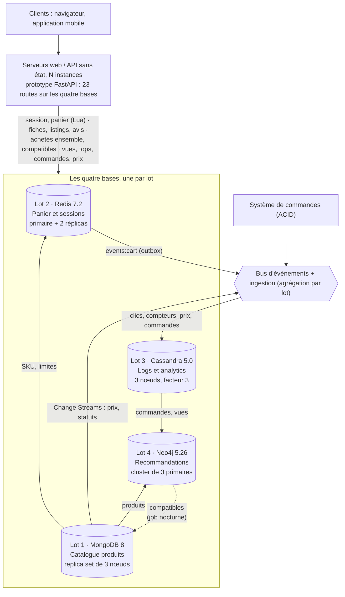
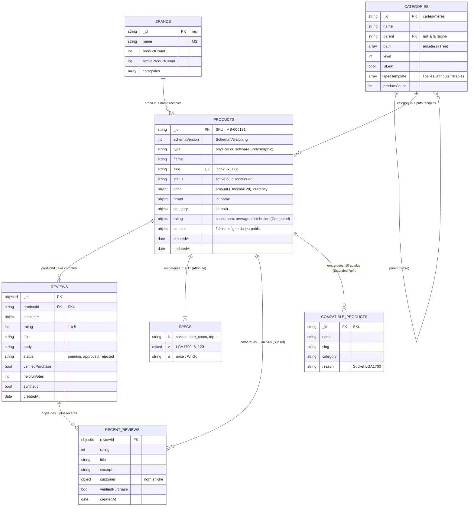
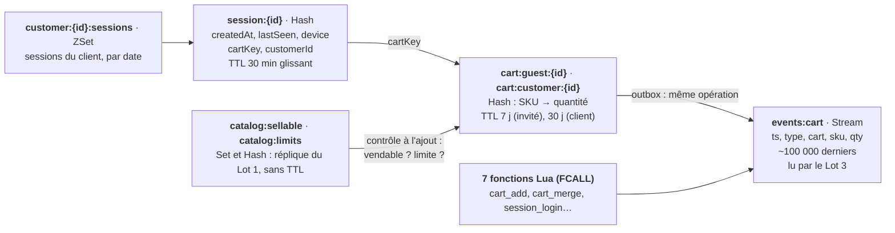
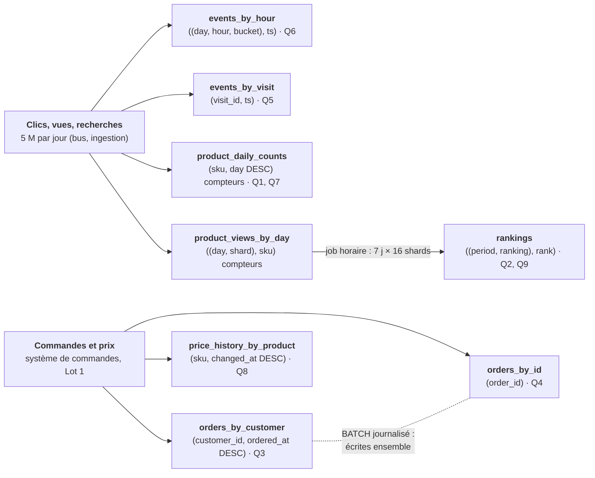
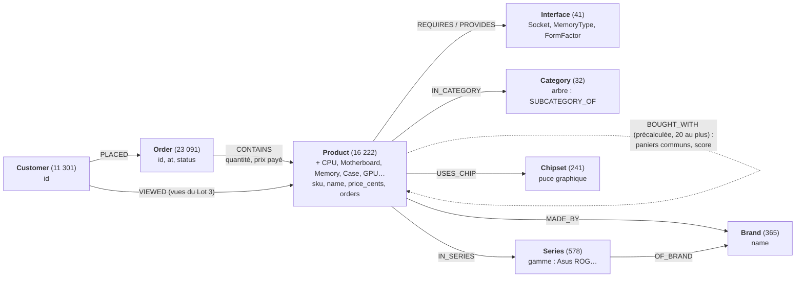

# Document de conception — Refonte des données de LDLC

> Projet NSL NoSQL · Architecture polyglotte : MongoDB, Redis, Cassandra, Neo4j\
> **Binôme 1 :** FOPA DORCEL LE DOUX · **Binôme 2 :** LATOUNDJI Mohamed Farouck\
> 18 novembre 2026

---

## 1. Contexte et démarche

LDLC, site e-commerce high-tech, compte plus de 27 000 références et plus de 600 marques. Il reçoit des millions de visites par mois, avec des pics à chaque sortie de composant, et expédie jusqu’à 25 000 colis par jour. Sa base relationnelle monolithique ne suit plus. Nous appliquons la **persistance polyglotte** : chaque besoin reçoit la famille NoSQL adaptée à sa façon d’accéder aux données.

Chaque lot est présenté selon la même structure : besoins et **choix technologique**, **schéma**, **justification des compromis**, puis **requêtes types avec exemples** exécutés. La démarche est la même pour chaque lot :

1.  lister les requêtes métier et la charge ;
2.  placer le besoin dans le théorème CAP ;
3.  choisir la famille, puis la technologie, en écartant les alternatives ;
4.  modéliser à partir des requêtes ;
5.  écrire les compromis ;
6.  prouver le modèle par des requêtes types exécutées et mesurées.

| Lot | Besoin dominant | Famille | Technologie | CAP |
|----|----|----|----|----|
| 1. Catalogue | Schéma variable selon la catégorie, très lu, sous-documents | Document | MongoDB 8 | CP |
| 2. Panier et sessions | Moins d’une milliseconde, expiration automatique, partage entre serveurs | Clé-valeur | Redis 7.2 | AP, perte bornée à ~1 s |
| 3. Logs et analytics | Écritures massives, séries temporelles, rétention longue | Colonne (wide-column) | Cassandra 5.0 | AP, cohérence réglable |
| 4. Recommandations | Parcours de relations sur plusieurs niveaux | Graphe | Neo4j 5.26 | CP en cluster |



*Figure 1 — Vue d'ensemble : chaque lot a sa base, et les bases échangent par des flux, jamais par des lectures croisées. Trait plein : flux de données ; pointillé : job nocturne.*

---

## 2. Lot 1 — Catalogue produits (MongoDB)

### 2.1 Besoins et choix technologique

Le jeu public PC Part Dataset (licence MIT) fournit 66 778 produits réels en 25 catégories : 16 222 en vente, 50 556 arrêtés. Chaque catégorie a ses propres attributs : un processeur a `core_count` et `tdp`, une carte mère `socket` et `form_factor`. Le jeu n’a pas d’avis : 96 236 avis synthétiques sont générés de façon déterministe.

| \# | Requête métier | Fréquence | Exigence |
|----|----|----|----|
| R1 | Fiche produit : caractéristiques, note, derniers avis, compatibles | Très forte | Une seule lecture |
| R2, R3 | Catégorie **et sous-catégories**, triée par prix, filtrée par caractéristiques (socket, cœurs, TDP) | Très forte | Tri porté par l’index, attributs variables |
| R4 | Facettes : nombre de produits par valeur de filtre | Forte | Définies par catégorie |
| R5 à R8 | Avis suivants, recherche plein texte, produits d’une marque, mieux notés | Moyenne à forte | Pagination, pertinence |
| E, I, U | Avis et modération, prix, renommage, création et import de fiches, votes, anonymisation | Faible | Atomiques, sans doublon, rejouables |
| V1 à V3 | Nouvelle catégorie, nouvel attribut, changement de structure | Rare | **Sans migration** |

**Choix : MongoDB 8, base orientée document.** Un document n’a pas de structure imposée, et la validation se limite au tronc commun. Ajouter un attribut ou une catégorie revient à écrire des documents, sans `ALTER`.

| Alternative | Pourquoi pas pour le catalogue |
|----|----|
| PostgreSQL + JSONB | Crédible (index GIN), mais on reste relationnel : montée en charge horizontale moins native, jointures pour les avis et les compatibles |
| Cassandra | Filtres limités à la clé primaire : impossible sur des attributs qui changent selon la catégorie |
| Redis | Un document serait une valeur opaque, sans index secondaire |
| Elasticsearch | Excellent pour la recherche et les facettes, mais pas une base de référence. Évolution possible, alimentée depuis MongoDB |

### 2.2 Schéma



*Figure 2 — Schéma du Lot 1 : quatre collections et les sous-documents embarqués dans la fiche produit, avec leurs champs et leurs cardinalités. La fiche recopie ce qu'elle affiche et se lit en un seul document ; `reviews` reste la source de vérité des avis.*

Extrait d’un document :

```javascript
{ "_id": "MB-000131", "schemaVersion": 1, "type": "physical",        // SKU · Schema Versioning · Polymorphic
  "name": "MSI PRO B760-P WIFI DDR4", "slug": "msi-pro-b760-p-wifi-ddr4-mb-000131",
  "brand": {"id": "msi", "name": "MSI"},                                // Extended Reference
  "category": {"id": "cartes-meres", "path": ["composants", "cartes-meres"]},   // Tree
  "price": {"amount": Decimal128("159.95"), "currency": "USD"},          // jamais de flottant
  "specs": [{"k": "socket", "v": "LGA1700"}, {"k": "max_memory", "v": 128, "u": "Go"}],   // Attribute
  "rating": {"count": 21, "sum": 91, "average": 4.33, "distribution": {...}},  // Computed
  "recentReviews": [ /* 5 au plus */ ],                                 // Subset
  "compatibleProducts": [{"_id": "CPU-000248", "name": "Intel Core i9-13900", "reason": "Socket LGA1700"}] }
```

**Embarquer ou référencer.** Ce qui est lu ensemble est stocké ensemble, sauf si la liste n’est pas bornée ou si elle est modifiée à part.

| Donnée | Relation | Décision |
|----|----|----|
| Caractéristiques, infos logiciel | 1 à peu, bornée, lue avec la fiche | **Embarquées** (Attribute, Polymorphic) |
| Marque, catégorie | N à 1, rarement modifiées | **Référence et nom recopié** (et chemin de la catégorie) |
| Avis | 1 à N, jusqu’à 1 163, modérés et votés | **Collection** `reviews`, 5 derniers embarqués, note précalculée |
| Produits compatibles | N à N | **10 références au plus** ; les relations complètes sont au Lot 4 |
| Stock, historique des prix | Très changeant, ou non borné | **Hors fiche** : système de commandes, Lot 3 |

| Pattern | Où | Problème résolu | Coût accepté |
|----|----|----|----|
| Polymorphic | `products` unique, champ `type` | 25 familles interrogeables ensemble | Validation limitée au tronc commun |
| Attribute | `specs: [{k, v, u}]` | Un seul index pour tous les attributs filtrables | Requêtes `$elemMatch` plus verbeuses |
| Extended Reference | marque, catégorie, compatibles | Afficher sans `$lookup` | Mise à jour en masse au renommage : 1 869 fiches en 231 ms |
| Subset, Computed | `recentReviews`, `rating` | Fiche légère, note sans relire les avis | Maintenus à l’écriture, réconciliation idempotente |
| Tree | `category.path` | Catégorie et sous-catégories en une égalité | Recalcul si une branche est déplacée |
| Schema Versioning | `schemaVersion` | Changer une structure sans migration globale | Lecture des deux versions pendant la transition |

**Index.** Chaque index est conçu pour une requête, selon la règle ESR (égalité, puis tri, puis plage

| Index | Champs | Requête | Mesure (`explain`) |
|----|----|----|----|
| `ux_slug` | `slug` (unique) | R1 | 1 clé, 1 document |
| `ix_listing_prix` | `category.path`, `price.amount`, `_id` | R2 | 5 clés pour 5 résultats, sans tri en mémoire |
| `ix_facettes` | `category.id`, `specs.k`, `specs.v` | R3, V1 | 25 clés pour 11 résultats ; sert aussi les attributs créés plus tard |
| `ix_marque` | `brand.id`, `category.id`, `price.amount` | R7 | 154 documents lus au lieu de 1 256 |
| `tx_recherche` | texte : `name` (poids 10), `brand.name` (5) | R6 | Sans racinisation : ce sont des noms de modèles |
| `reviews.ix_avis_produit` | `productId`, `status`, `createdAt` | R5 | 10 clés, 5 documents |

### 2.3 Justification des compromis

- **Des noms recopiés, pour lire une fiche en un seul document.**

  La contrepartie, une mise à jour en masse au renommage, est mesurée et porte sur une opération rare. Le prix, qui change souvent, n’est recopié nulle part.

- **Pas de transaction entre l’avis et le résumé de la fiche.**
- **Une validation partielle,** limitée au tronc commun : c’est le prix d’un schéma qui évolue sans migration. La cohérence des attributs vient du gabarit de la catégorie.
- **Des compatibilités simplifiées,** par socket et par format : le Lot 4 les recalcule.

### 2.4 Requêtes types et exemples

```python
db.products.find({"category.id": "processeurs", "status": "active",            // R3 : facettes variables
    "specs": {"$all": [{"$elemMatch": {"k": "socket", "v": "AM5"}},
                       {"$elemMatch": {"k": "core_count", "v": {"$gte": 8}}},
                       {"$elemMatch": {"k": "tdp", "v": {"$lte": 120}}}]},
    "price.amount": {"$lte": Decimal128("500")}}).sort("price.amount", 1)

# E2 : un avis 5 étoiles approuvé met à jour la note et les avis récents en une seule écriture atomique
db.products.update_one({"_id": "MB-000131"}, [{"$set": {
    "rating.count": {"$add": ["$rating.count", 1]}, "rating.sum": {"$add": ["$rating.sum", 5]},
    "rating.average": {"$round": [{"$divide": [{"$add": ["$rating.sum", 5]},
                                                {"$add": ["$rating.count", 1]}]}, 2]},
    "recentReviews": {"$slice": [{"$concatArrays": [[nouvel_avis], "$recentReviews"]}, 5]}}}])
# Note : 4,33 (21 avis) -> 4,36 (22 avis), identique au recalcul complet depuis reviews (E7)
```

---

## 3. Lot 2 — Panier et sessions (Redis)

### 3.1 Besoins et choix technologique

| Opération | Fréquence | Exigence |
|----|----|----|
| Lire la session | À chaque requête HTTP, sur tout serveur web | Moins d’1 ms, partagée entre serveurs |
| Ajouter au panier | Forte, pics aux sorties de composants | Atomique, produit vendable, limite par client |
| Afficher le panier | Forte (badge sur chaque page) | Moins d’1 ms |
| Se connecter | Moyenne | Fusionner le panier invité, sans double fusion |
| Expirer après inactivité | Continue | Automatique, sans job de purge |

**Choix : Redis 7.2, base clé-valeur en mémoire.** La latence est inférieure à la milliseconde et chaque clé a un TTL natif. Redis est partagé par des serveurs web sans état, offre des structures riches (Hash, Set, Sorted Set, Stream) et exécute des fonctions Lua côté serveur. La 7.2 est la dernière version sous licence BSD ; en production, Valkey 8 ou Redis 8 conviennent.

| Alternative | Pourquoi pas |
|----|----|
| Sessions collantes en mémoire du serveur web | Perdues au redémarrage, charge déséquilibrée |
| Memcached | Pas de structures, ni persistance, ni réplication |
| MongoDB ou Cassandra avec TTL | Expiration différée ou tombstones, latence de l’ordre de la milliseconde |
| Jeton signé (JWT) | Non révocable, et un panier ne tient pas dans un cookie |

### 3.2 Schéma



*Figure 3 — Schéma du Lot 2 : la session pointe vers le panier ; chaque modification du panier publie son événement dans la même opération.*

| Clé | Structure | Contenu | Durée de vie |
|----|----|----|----|
| `session:{id}` | Hash | création, activité, appareil, `cartKey`, `customerId` | 30 min glissantes |
| `cart:guest:{id}`, `cart:customer:{CUST-…}` | Hash | SKU → quantité | 7 et 30 jours glissants |
| `customer:{id}:sessions` | Sorted set | sessions du client, par date | 30 jours |
| `catalog:sellable`, `catalog:limits` | Set, Hash | SKU vendables, limites (RTX 5090 : 2) : réplique du Lot 1 | permanente |
| `events:cart` | Stream | événements du panier, lus par le Lot 3 | ~100 000 derniers |

### 3.3 Justification des compromis

- **AP, avec une perte bornée à environ 1 s.** Pendant une sortie de composant, refuser un ajout au panier coûte plus cher que perdre la dernière modification lors d’une bascule rare.
- **Pas de Redis Cluster :** environ 120 Mo au pic visé (225 octets par session, environ 130 par panier), et un seul nœud a traité plus de 11 000 ajouts par seconde sur un portable. Le Cluster gênerait aussi les fonctions multi-clés, comme la fusion de paniers.
- **De la logique métier dans la base,** en Lua : on gagne l’atomicité et un seul aller-retour. Le code est versionné dans le dépôt et exercé par les requêtes types.
- **Une réplique du catalogue à jour à terme,** pour ne pas interroger MongoDB à chaque ajout. Elle est rechargée par bascule atomique (`RENAME`), donc jamais vide ni à moitié chargée. Si la mémoire est pleine, `volatile-lru` évince les paniers les moins récents, jamais cette réplique.

### 3.4 Requêtes types et exemples

21 sections sont exécutables (sessions, panier, mesures).

```text
> FCALL cart_add 4 cart:guest:demo-g1 catalog:sellable catalog:limits events:cart GPU-000009 5 604800 10
1) (integer) 2    2) (integer) 2    3) (integer) 2       # 5 demandées : la RTX 5090 est limitée à 2
> FCALL cart_add 4 cart:guest:demo-g1 catalog:sellable catalog:limits events:cart CPU-000025 1 604800 10
(error) NOTSELLABLE produit non vendable : CPU-000025
> FCALL cart_merge 4 cart:guest:demo-g1 cart:customer:CUST-000042 catalog:limits events:cart 2592000 10
(integer) 2                                              # 2 lignes fusionnées ; MB-000131 : 1 + 2 = 3
```

| Appel (1 client, sans réseau)         | p50     | p95     | p99          |
|---------------------------------------|---------|---------|--------------|
| `PING` (référence)                    | 0,10 ms | 0,20 ms | 0,41 ms      |
| `session_touch`                       | 0,14 ms | 0,32 ms | 0,57 ms      |
| `cart_add` (5 contrôles et écritures) | 0,18 ms | 0,45 ms | 0,8 à 1,3 ms |

---

## 4. Lot 3 — Logs et analytics (Cassandra)

### 4.1 Besoins et choix technologique

| \# | Requête | Exigence |
|----|----|----|
| Q1, Q7 | Vues d’un produit aujourd’hui, sur 30 jours | Un chiffre, une lecture |
| Q2, Q9 | Top des produits de la semaine (global, par catégorie) ; recherches fréquentes et sans résultat | Une lecture, frais à l’heure |
| Q3, Q4 | Historique des commandes d’un client ; commande par numéro | Plus récente d’abord, paginé, à jour juste après l’achat |
| Q5, Q6 | Parcours d’une visite ; événements bruts d’une heure | Ordre chronologique, sans balayer la table |
| Q8 | Prix le plus bas des 30 jours précédant une promotion | Exact : directive Omnibus |

La charge visée est de 5 millions d’événements par jour, 15 millions un jour de sortie, dont 1,5 million dans l’heure qui suit l’ouverture des ventes. Les écritures dominent, en ajout seul ; les données vieillissent, puis expirent.

**Choix : Cassandra 5.0, base orientée colonne (wide-column).** Les données sont des partitions de lignes triées, réparties par hachage sur des nœuds égaux. Une écriture est un ajout en mémoire et au journal, puis un fichier immuable : son coût ne dépend pas du volume déjà stocké. On ajoute des nœuds pour ajouter du débit, sans primaire. Le TTL par cellule et la compaction par fenêtre de temps font expirer les données sans effort. Contrepartie : ni jointure, ni tri ou agrégat arbitraire, d’où **une table par requête**.

| Alternative | Pourquoi pas |
|----|----|
| MongoDB, collections time series | Les écritures passent par un primaire par shard |
| Redis Streams | En mémoire : des mois de rétention coûteraient des centaines de Go de RAM |
| ClickHouse, Druid | Excellents en agrégat ad hoc, moins pour la lecture par clé ; candidats pour l’analyse libre |
| HBase | Même modèle, mais une exploitation plus lourde (HDFS, ZooKeeper) |

### 4.2 Schéma



*Figure 4 — Schéma du Lot 3 : 8 tables pour 9 requêtes ; chaque requête lit une partition dont la clé est connue d'avance. Chaque clic est écrit 2 fois (journal, parcours) et compté 2 fois (par produit, par jour et shard).*

| Table | Partition | Clustering | Requêtes | Rétention |
|----|----|----|----|----|
| `events_by_hour` | `(day, hour, bucket)` | `ts, event_id` | Q6 | 90 jours (TTL) |
| `events_by_visit` | `visit_id` | `ts, event_id` | Q5 | 90 jours (TTL) |
| `product_daily_counts` (compteurs) | `sku` | `day DESC` | Q1, Q7 | 25 mois |
| `product_views_by_day` (compteurs) | `(day, shard)` | `sku` | job de Q2 | 25 mois |
| `rankings` | `(period, ranking)` | `rank` | Q2, Q9 | 25 mois |
| `orders_by_customer` | `customer_id` | `ordered_at DESC, order_id` | Q3 | 10 ans |
| `orders_by_id` | `order_id` | — | Q4 | 10 ans |
| `price_history_by_product` | `sku` | `changed_at DESC` | Q8 | conservé |

1.  **Un bucketing contre la partition chaude.** Une partition par heure recevrait 1,5 million de lignes (176 Mo) sur les 3 mêmes réplicas le jour d’une sortie. Avec `bucket = event_id mod 16`, elle n’en reçoit que 94 000 (11 Mo), réparties sur le cluster. Le lecteur connaît les 16 buckets. À l’heure de la sortie simulée, chacun a entre 57 et 83 lignes.
2.  **Des compteurs à l’écriture, agrégés par lot.** L’ingestion regroupe quelques secondes d’événements, puis fait un incrément de +734 au lieu de 734 incréments. Q1 lit un chiffre, sans rien compter.
3.  **Un top de la semaine précalculé.** CQL refuse `ORDER BY views` et `GROUP BY category`. Un job horaire lit 7 jours × 16 shards, soit 112 partitions connues ; il additionne, trie, puis écrit des classements déjà triés. Q2 lit alors une partition. Le shard vaut CRC32(SKU) mod 16 ; sans lui, une partition par jour recevrait toutes les écritures du site.
4.  **Des commandes recopiées,** avec leurs lignes dans un type `order_line`. Les deux tables sont écrites par un BATCH journalisé, seul usage légitime d’un lot multi-partition.
5.  **Des écritures propres :** un champ absent est envoyé en `UNSET`, jamais en `null`, qui créerait une tombstone par cellule. Le TTL est compté depuis la date de l’événement, la compaction se fait par fenêtre d’un jour, et un lot non journalisé ne touche qu’une partition.

### 4.3 Justification des compromis

- **Des données dupliquées :** chaque clic est écrit deux fois et compté deux fois. Le stockage est bon marché ; une lecture qui balaierait le cluster ne l’est pas.
- **Des classements frais à l’heure, pas à la seconde :** c’est le prix d’une lecture en une partition, et cela suffit pour une vitrine. Compter à la lecture coûterait des millions de lignes ; les vues matérialisées, expérimentales en 5.0, ne savent pas trier sur un agrégat.
- **Des compteurs approximatifs :** un compteur n’est pas idempotent (un rejeu compte deux fois) et n’accepte pas de TTL. Le chiffre exact se recalcule depuis le journal brut.
- **Les commandes sont un historique, pas la source de vérité :** le paiement et le stock exigent l’ACID du système de commandes.
- **AP, avec une cohérence réglée requête par requête,** sur 3 nœuds en 3 zones avec un facteur de réplication de 3 :

| Données | Écriture | Lecture | Raison |
|----|----|----|----|
| Événements, compteurs | `LOCAL_ONE` | `LOCAL_ONE` | Un clic perdu ou en retard est sans conséquence |
| Commandes, prix | `LOCAL_QUORUM` | `LOCAL_QUORUM` | 2 + 2 \> 3 : le client voit sa commande juste après l’achat, et le prix de référence a une valeur légale |
| Classements | `LOCAL_QUORUM` (job) | `LOCAL_ONE` | Écrits chaque heure, lus très souvent |

Une requête nouvelle demande une table nouvelle, remplie depuis le journal : l’analyse libre ira à un moteur OLAP alimenté par le même flux.

### 4.4 Requêtes types et exemples

20 sections sont exécutables (lectures Q1 à Q9, écritures, mesures). Le prix de référence Omnibus (Q8) se lit en deux requêtes dans la même partition : le prix en vigueur au début de la fenêtre, puis le minimum depuis.

```text
cqlsh> SELECT rank, item, label, value FROM rankings                                       -- Q2 : une partition
       WHERE period = 'week:2026-W47' AND ranking = 'products:all' LIMIT 3
   1 | GPU-000009 | Asus ROG Astral OC  | 2719        <- la RTX 5090, sortie lundi
   2 | GPU-000309 | MSI GAMING TRIO OC  | 150
   [trace] Executing single-partition query on rankings · Read 3 live rows and 0 tombstone cells
cqlsh> SELECT changed_at, price FROM price_history_by_product                              -- Q8 : Omnibus
       WHERE sku = 'MON-000351' AND changed_at <= '2026-10-19' LIMIT 1
   2026-09-19 | 89.99
cqlsh> SELECT min(price) AS lowest FROM price_history_by_product
       WHERE sku = 'MON-000351' AND changed_at > '2026-10-19'
   79.99                                                 <- prix de référence légal : min(89.99, 79.99)
```

Pour MON-000351, la référence est de 79,99 \$ alors que le prix courant est de 89,99 \$ : une remise annoncée à −15 % n’est donc réellement que de 4,4 %.

**Mesures** (un nœud Docker, sur un portable) :

- **lecture d’une partition :** 3 à 10 ms, sans tombstone ;
- **écriture d’un événement :** p50 entre 2 et 3,5 ms ;
- **débit :** 1 750 à 2 000 événements par seconde avec 32 clients, pour un besoin d’environ 420 par seconde au pic d’une sortie ;
- **disque :** 121 octets par événement, soit environ 0,16 To pour 90 jours à 5 millions d’événements par jour, sur 3 réplicas.

Les données de démonstration couvrent 7 jours d’événements (environ 97 000), 28 jours de compteurs, et 12 mois de commandes (environ 23 000, composées comme de vrais paniers) et de prix.

---

## 5. Lot 4 — Recommandations (Neo4j)

### 5.1 Besoins et choix technologique

| \# | Requête | Exigence |
|----|----|----|
| R1 | Souvent achetés ensemble (fiche produit) | Quelques ms, quelle que soit la popularité du produit |
| R2, R3 | « Ont acheté ce processeur, ont aussi acheté cette carte mère » ; compatibles avec ce boîtier | Seulement des produits compatibles ; 1 ou 2 niveaux d’interfaces |
| R4, R5 | Configuration complète autour d’un processeur ; compléter un panier (Lot 2) | Compatible avec **tout** le panier |
| R6, R7 | Recommandations d’un client ; « amis d’amis » | 4 sauts, sans se perdre dans les best-sellers |
| R8 à R11 | Vu sans achat, alternatives de même puce, même gamme, explication | Le chemin lui-même, en clair |
| — | Liste courte `compatibleProducts` pour le Lot 1 | 10 produits au plus par fiche |

**Choix : Neo4j 5.26 LTS, base orientée graphe.** Le besoin est un parcours de relations. Dans un graphe de propriétés, chaque nœud pointe directement vers ses relations : le coût d’une requête dépend des arêtes parcourues, pas de la taille de la base. Cypher écrit les parcours comme des motifs, `(cpu)-[:R``EQUIRES]->(:Socket)<-[:PROVIDES]-(carte)`, au lieu d’une jointure par niveau.

| Alternative | Pourquoi pas |
|----|----|
| MongoDB, `$graphLookup` | Un seul type de relation par parcours ; le coût croît vite avec la profondeur |
| SQL, jointures récursives | Une auto-jointure par niveau : « amis d’amis » en demande 4 |
| Memgraph, ArangoDB, Neptune | Licence BSL ; langage AQL moins répandu ; service lié à un seul fournisseur cloud |

### 5.2 Schéma



*Figure 5 — Schéma du Lot 4 : ce que l'on parcourt devient un nœud ; la compatibilité passe par des nœuds d'interface.*

Le graphe compte 51 871 nœuds et 151 042 arêtes, chargés en 1 min 30 environ à partir des exports des Lots 1 et 3. Neo4j n’a pas de type décimal : les prix y sont en centimes entiers.

1.  **La compatibilité passe par des nœuds d’interface.** Un processeur exige un socket, que la carte mère fournit ; une barrette exige un type de mémoire, que la carte mère fournit ; une carte mère exige un format, que le boîtier fournit. Cela fait 8 808 arêtes vers 41 interfaces, au lieu de 1 861 130 arêtes directes entre produits compatibles, soit 211 fois plus. Une nouvelle carte mère ajoute 3 arêtes, et un nouveau critère (emplacements M.2, longueur des cartes graphiques) ajoute des nœuds sans changer les requêtes.
2.  **La commande reste un nœud :** « achetés ensemble » veut dire « dans le même panier », pas seulement « par le même client ».
3.  **« Achetés ensemble » est une arête précalculée** (`BOUGHT_WITH`) : chaque nuit, un job écrit pour chaque produit ses 20 meilleurs partenaires (4 216 arêtes). Le score est un cosinus : les paniers communs divisés par √(commandes de p × commandes de q), avec au moins 2 paniers communs. Il pénalise les produits présents partout.
4.  **Des attributs déduits par règle :** le type de mémoire d’une carte mère vient de son nom (« DDR4 », ou l’abréviation « D4 » des noms Asus et ASRock), sinon de son socket, soit 928 cartes sur 951. La gamme est le mot qui suit la marque (« Asus ROG »), retenu à partir de 3 produits.
5.  **Le graphe est une copie.** Il reçoit les produits du Lot 1, les commandes et les vues du Lot 3. Il renvoie au Lot 1 la liste `compatibleProducts`, classée par paniers réels, puis par popularité. Le générateur du Lot 3 compose chaque commande selon une intention d’achat (montage aux pièces compatibles, évolution, périphériques, achat isolé) : 4 950 commandes contiennent un processeur et une carte mère, dont 4 917 au même socket.

### 5.3 Justification des compromis

- **Une fraîcheur d’un jour pour « achetés ensemble » : le compromis central.** Calculé à la volée, R1 lirait toutes les commandes d’un best-seller à chaque affichage. Précalculé, il lit 20 arêtes au plus, quelle que soit la popularité du produit (mesure M4 ci-dessous).
- **Des supernœuds jamais traversés en entier :** l’interface DDR5 compte 1 752 arêtes, la catégorie mémoire 2 907 produits. Les parcours passent par l’interface ciblée, jamais par la catégorie (M6). R7 garde 25 voisins au plus et pondère chaque produit par 1/log(popularité), pour qu’un best-seller ne soit pas recommandé à tout le monde.
- **Le démarrage à froid :** un produit nouveau n’a pas d’historique d’achat. Il est recommandé par ses interfaces et sa popularité jusqu’au calcul suivant.
- **Un socket commun ne garantit pas tout** (chipset, BIOS) : le modèle l’accepte sans refonte, en ajoutant des interfaces plus fines. Les attributs déduits par règle sont documentés et vérifiables, mais imparfaits.
- **CP en cluster, et une donnée dérivée.** En production, un cluster de 3 primaires (consensus Raft) sert les écritures, rares, et les secondaires servent les lectures des fiches. Le graphe se reconstruit depuis les Lots 1 et 3 : s’il tombe, la fiche affiche la liste du Lot 1. Le prototype d’API applique ce repli, avec un délai de 3 s au plus. On peut donc démarrer avec l’édition Community et payer la licence du cluster (Enterprise ou Aura) quand le trafic le justifie.

### 5.4 Requêtes types et exemples

17 sections sont exécutables (R1 à R11, mesures M1 à M6). R5, compléter un panier, retient une suggestion si chaque interface qu’elle exige est fournie par le panier, et si elle fournit ce que le panier exige d’elle : pour un processeur AM5 et une carte mère Mini ITX en DDR5, la mémoire proposée est en DDR5, et le boîtier accepte le Mini ITX.

```cypher
MATCH (p:Product {sku: $sku})-[r:BOUGHT_WITH]->(q:Product)                      // R1, sur 20 arêtes au plus
RETURN q.sku, q.name, q.category, r.orders AS paniers_communs ORDER BY r.score DESC LIMIT 6
// CPU-000054 (Ryzen 9 9900X3D, AM5) : MB-000006 Gigabyte B650 EAGLE AX (10 paniers communs),
//   MB-000227 Gigabyte B650I AX (17), MB-000049 ASRock B850M Pro-A WiFi (15), RAM-001835 DDR5 (4)…

// R5 : le panier vient de Redis (Lot 2) ; les suggestions viennent des arêtes BOUGHT_WITH de ses articles
MATCH (p:Product) WHERE p.sku IN $panier
WITH collect(p) AS panier UNWIND panier AS p
MATCH (p)-[r:BOUGHT_WITH]->(reco:Product)
WHERE NOT reco IN panier AND NOT reco.category IN [x IN panier | x.category]
WITH panier, reco, sum(r.score) AS score
// 1. ce que la suggestion exige, le panier le fournit (ou le panier n'a rien de ce type)
WHERE all(i IN [(reco)-[:REQUIRES]->(j) | j] WHERE
          any(x IN panier WHERE (x)-[:PROVIDES]->(i))
          OR none(x IN panier WHERE EXISTS { (x)-[:PROVIDES]->(:Interface {kind: i.kind}) }))
// 2. ce que le panier exige, la suggestion le fournit (si elle fournit ce type d'interface)
  AND all(x IN panier WHERE all(i IN [(x)-[:REQUIRES]->(j) | j] WHERE
          NOT EXISTS { (reco)-[:PROVIDES]->(:Interface {kind: i.kind}) } OR (reco)-[:PROVIDES]->(i)))
RETURN reco.sku, reco.name, reco.category, score ORDER BY score DESC LIMIT 6
// CPU-000054 + MB-000227 : NZXT H9 Elite (accepte le Mini ITX), TEAMGROUP Elite 32 GB (DDR5), Jonsbo C6-ITX…
```

| Mesure (cache chaud) | À la volée, ou par le chemin large | Précalculé, ou par l’interface ciblée |
|----|----|----|
| M4 · achetés ensemble du produit le plus vendu | 2 492 accès à la base, 6 à 21 ms | 78 accès, 1 à 3 ms |
| M5 · recommandations d’un client | R7 par client (4 sauts) : 18 574 accès, 21 à 28 ms | R6 par produit : 1 123 accès, 3 ms |
| M6 · barrettes compatibles avec une carte DDR5 | par la catégorie : 81 990 accès, 89 ms | par l’interface : 37 993 accès, 20 ms |
| Liste `compatibleProducts` pour le Lot 1 | — | 5 157 fiches en 51 s ; `--annuler` restaure exactement les listes d’origine |

À cette taille de graphe, tout reste sous 100 ms. Ce qui compte est la croissance : à la volée, le coût suit le nombre de ventes du produit, alors que la lecture précalculée reste bornée à 20 arêtes.

---

## 6. Synthèse transversale

| Lot | CAP | Cohérence retenue | Source de vérité de… |
|----|----|----|----|
| 1. MongoDB | CP | Forte à l’écriture (`majority`), à terme en lecture publique | fiches, catégories, marques, avis |
| 2. Redis | AP | Forte pour le client (primaire unique), à terme pour la réplique du catalogue | sessions, paniers, événements du panier |
| 3. Cassandra | AP | `LOCAL_ONE` pour les événements, `LOCAL_QUORUM` pour les commandes et les prix | navigation, agrégats, classements, prix |
| 4. Neo4j | CP | Donnée dérivée, recalculée chaque nuit | rien en propre : tout est reconstructible |
